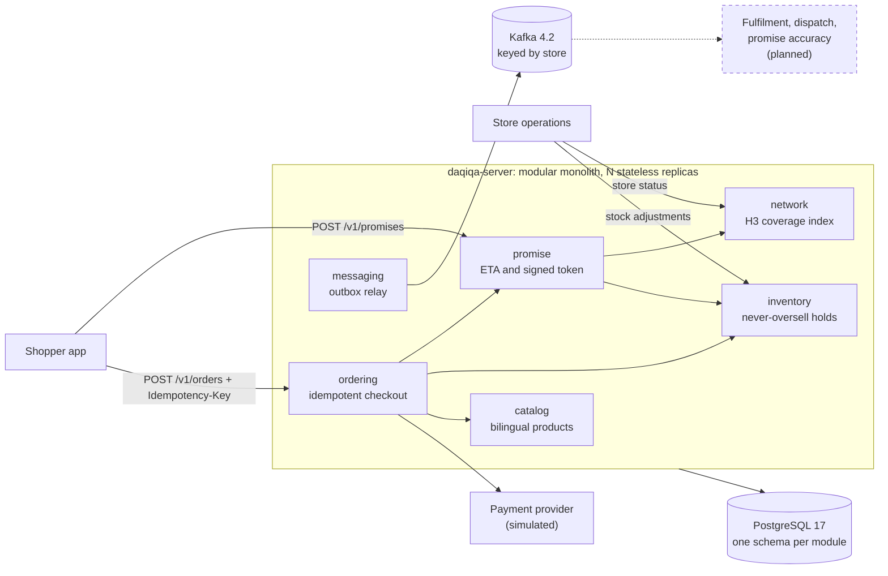

# Daqiqa · دقيقة

**Delivery promises you can trust, in minutes.** Daqiqa (Arabic for "minute") is the engine behind a 15-minute
delivery button, the kind of service Noon Minutes and Amazon Now run in the Gulf. For each basket and address it
calculates how fast the order can really arrive, holds the exact items so they can never be oversold, and turns the
promise into exactly one order.

Java 21 · Spring Boot 4.1 · PostgreSQL 17 · Kafka 4.2 · Uber H3. A modular monolith whose boundaries are enforced by
tests.

> **Status:** the promise-to-order core runs end to end on Dubai demo data (waves 0 and 1 are done). Fulfilment,
> dispatch and the city simulator come next. The [status table](#status) says exactly what runs today.

**By the numbers:** 571 tests, all passing on real PostgreSQL · `CheckoutEndToEndTest` drives promise, order, replay,
stock and outbox over HTTP through every real module · promise p99 ≤ 14 ms at 2,370 requests/s in a
[first baseline](docs/benchmarks/2026-09-22-promise-baseline.md) on a shared 2-vCPU sandbox (target: p99 < 25 ms at
1,000 requests/s per instance).

## Why this exists

- **A fixed "15 minutes" is a guess.** Delivery time depends on the store's queue, the basket, rider availability and
  distance. Under Daqiqa's v1 model, a quiet store delivers a 3-item basket within 15 minutes up to 3.0 km away in a
  straight line; a busy one, only up to 1.1 km.
- **The last unit is contested.** At peak, many shoppers order the same items from the same store at the same moment.
  Selling one unit twice means a cancellation after payment.
- **Networks drop responses.** Shoppers tap again and apps retry. Without idempotency that is two orders, two holds
  and two charges.

## What makes it interesting

| Hard problem | Mechanism | Status | Read |
|---|---|---|---|
| Never oversell the last unit | Lock the basket's `(store, SKU)` rows in one sorted order (`FOR UPDATE`) so baskets cannot deadlock; every status change guarded in SQL; `CHECK (reserved <= on_hand)` as the last line; holds expire and are swept with `SKIP LOCKED` | Done | [ADR-0005](docs/adr/0005-never-oversell-inventory-reservations.md), [design](docs/design/inventory.md) |
| "Who can deliver here?" in constant time | H3 resolution-9 cells covering each store's radius plus one cell, in an immutable in-memory index; exact distance only for the few candidates | Done | [ADR-0006](docs/adr/0006-h3-for-coverage.md), [design](docs/design/promise.md) |
| Honour exactly the promise shown | HMAC-SHA256 token binds store, tier, ETA, expiry and a basket hash; verified at checkout without I/O; key ids allow rotation | Done | [ADR-0007](docs/adr/0007-signed-promise-tokens.md) |
| A promise holds for this address and this store only | The token also signs the location: a delivery point more than 100 m away is refused (`PROMISE_LOCATION_MISMATCH`), and so is a store that stopped taking orders (`STORE_UNAVAILABLE`) | Done | [ADR-0007](docs/adr/0007-signed-promise-tokens.md), [design](docs/design/promise.md) |
| One tap, one order, one charge | `Idempotency-Key` claimed with a lease; the order id fixed at the first claim and reused by the reservation and the payment; byte-exact replays marked `Idempotent-Replayed: true` | Done | [ADR-0008](docs/adr/0008-idempotency-keys.md), [design](docs/design/ordering.md) |
| One promise, one live order | A partial unique index on live orders' promise ids, plus a per-promise advisory lock taken before any stock is held, so a racing second order is told `PROMISE_ALREADY_USED` | Done | [ADR-0008](docs/adr/0008-idempotency-keys.md), [design](docs/design/ordering.md) |
| No lost or phantom events | Transactional outbox; one relay per round, elected with a PostgreSQL advisory lock; Kafka by default with a producer checked for durability at startup; a failing event backs off and nothing overtakes it | Done | [ADR-0009](docs/adr/0009-transactional-outbox-and-kafka.md), [events](docs/architecture/events.md) |
| Boundaries that cannot erode | ArchUnit rules fail the build when a module reaches into another's internals or a domain imports a framework | Done | [ADR-0003](docs/adr/0003-hexagonal-modules-enforced-by-tests.md), [rules](platform/testing/src/main/java/io/daqiqa/testing/architecture/ArchitectureRules.java) |
| Proof under real concurrency | Tests on real PostgreSQL race the invariants: 200 threads reserve the last 50 units and exactly 50 win; 20 identical checkouts create one order; 8 keys racing for one promise get one order | Done | [ADR-0012](docs/adr/0012-testing-strategy.md), [harness](platform/testing/src/main/java/io/daqiqa/testing/postgres/PostgresTestDatabase.java) |

## Architecture



- **Read path:** a promise is one in-memory coverage lookup, one indexed SQL read and an HMAC. No writes.
- **Write path:** checkout claims its key, then runs two short transactions around the payment call. The first locks
  the promise and holds the stock with the new order; the second confirms the order together with its event and the
  stored response. No transaction is open while the card is authorized.
- **Events:** modules append to an outbox in the same transaction; a relay publishes to Kafka, so Kafka is off the
  request path.

The [architecture guide](docs/architecture/overview.md) covers modules, data ownership, consistency, sequence
diagrams for every key flow, failure modes and the evolution path.

## Status

| Capability | Wave | Status |
|---|---|---|
| Build, CI, formatting, shared kernel (UUIDv7 ids, `Money`, `GeoPoint`), event contracts | 0 | Done |
| Architecture rules (ArchUnit) and the real-PostgreSQL test harness | 0 | Done |
| Catalog: bilingual products, keyset pagination, problem details | 0 | Done |
| Server: health probes, Prometheus metrics, OpenAPI UI | 0 | Done |
| 14 ADRs, conventions, design notes with implementation notes, OpenAPI contract | 0–1 | Done |
| Network: dark stores, status, H3 coverage index | 1 | Done |
| Promise engine: ETA breakdown, tiers, suggestions, signed tokens bound to basket, address and store | 1 | Done |
| Inventory: never-oversell reservations, expiry sweeper, stock adjustments with an audit trail | 1 | Done |
| Ordering: idempotent checkout, simulated payment, abandoned-order sweeper, one live order per promise | 1 | Done |
| Messaging: transactional outbox, relay to Kafka with backoff | 1 | Done |
| Demo data: 12 Dubai stores, 52 products, stock for every product at every store | 1 | Done |
| Fulfilment (picking queue) and dispatch (riders, Redis GEO nearest-rider assignment) | 2 | Planned |
| Live order tracking over server-sent events | 2 | Planned |
| City simulator: Dubai and Riyadh presets, demand curves, accelerated clock, chaos events | 2 | Planned |
| Promise accuracy loop and self-calibrating buffers | 3 | Planned |
| OpenTelemetry tracing, Grafana dashboards, k6 load tests and chaos drills with published results | 3 | Planned |
| Ops console (Angular live map), Arabic and English search (OpenSearch), OAuth2 with Keycloak, Kubernetes and Terraform | 4 | Planned |

Goals, exit criteria and the known gaps are in the [roadmap](docs/roadmap.md).

## Quickstart

Prerequisites: Java 21 and Docker.

```bash
docker compose -f deploy/compose/compose.yaml up -d    # PostgreSQL 17 and Kafka 4.2
./gradlew :apps:daqiqa-server:bootRun                  # migrations, Dubai demo stores and stock, port 8080
```

Then open <http://localhost:8080/swagger-ui.html>, which serves the hand-written contract
([`api/openapi/daqiqa-v1.yaml`](api/openapi/daqiqa-v1.yaml), copied into the jar at build time). Also useful:
`/actuator/health`, `/actuator/prometheus` and `/v3/api-docs` (the document springdoc derives from the code).

`bootRun` runs the **`dev` profile** (`application-dev.yaml`): the Dubai demo data and a signing key published in this
repository. Every other way of starting the server brings its own keys and no demo data — and the server refuses to
start with the development key unless that profile is active, so the published key can never sign promises in a real
deployment:

```bash
java -jar apps/daqiqa-server/build/libs/daqiqa-server.jar \
  --spring.profiles.active=dev                                     # local run of the packaged jar
DAQIQA_PROMISE_TOKEN_KEY_ID=k1 DAQIQA_PROMISE_TOKEN_KEYS_K1=$(openssl rand -base64 32) \
  java -jar apps/daqiqa-server/build/libs/daqiqa-server.jar        # anywhere else: your own key
```

Events go to Kafka by default. To run without a broker, start the server with `DAQIQA_EVENT_PUBLISHER=logging`: each
event's envelope is logged and the event is marked published instead of sent.

| Variable | Default | Purpose |
|---|---|---|
| `DAQIQA_DB_URL` | `jdbc:postgresql://localhost:5432/daqiqa` | Database |
| `DAQIQA_DB_USER`, `DAQIQA_DB_PASSWORD` | `daqiqa`, `daqiqa` | Credentials (match the compose file) |
| `DAQIQA_DB_POOL_SIZE` | `20` | Connection pool size per instance |
| `DAQIQA_KAFKA_BOOTSTRAP_SERVERS` | `localhost:9092` | Kafka brokers |
| `DAQIQA_EVENT_PUBLISHER` | `kafka` | `logging` for runs without Kafka |
| `DAQIQA_PROMISE_TOKEN_KEY_ID` | none (`dev` profile: `dev`) | Id of the key that signs promises; without one the server does not start |
| `DAQIQA_PROMISE_TOKEN_KEYS_<ID>` | none (`dev` profile: the published development key) | Base64 key of at least 32 bytes for `<id>`, from your secret store. Keys other than the active one only verify (rotation) |
| `DAQIQA_FLYWAY_LOCATIONS` | `classpath:db/migration` (`dev` profile: plus `classpath:db/demo`) | Where Flyway reads migrations |
| `DAQIQA_LOG_FORMAT` | plain text | `ecs` for JSON logs |

**Tests.** `./gradlew build` checks formatting, compiles, and runs all 571 unit, property, integration, concurrency,
end-to-end and architecture tests. Integration tests use real PostgreSQL:

```bash
./gradlew build    # with Docker: Testcontainers starts postgres:17-alpine once per test JVM

# Without Docker: point the build at any PostgreSQL server whose user may create databases.
# Each test JVM creates its own database and drops it on exit.
export DAQIQA_TEST_PG_URL=jdbc:postgresql://localhost:5432/postgres
export DAQIQA_TEST_PG_USER=postgres DAQIQA_TEST_PG_PASSWORD=postgres   # the defaults
./gradlew build
```

## API walkthrough

The contract is [`api/openapi/daqiqa-v1.yaml`](api/openapi/daqiqa-v1.yaml). Money is in minor units (695 = 6.95 AED);
errors are RFC 9457 problem details with a stable `code`. The examples use `curl` and `jq`. The outputs below come
from a real run against the demo data, with `DAQIQA_EVENT_PUBLISHER=logging`; ids, tokens, times and stock levels vary
per run.

**0. Browse a category.** Keyset pagination: `nextCursor` is the last SKU of the page.

```bash
curl -s 'localhost:8080/v1/products?category=DAIRY_EGGS&limit=2' | jq
```

```json
{
  "items": [
    { "sku": "BUTTER-200G", "name": { "en": "Butter 200g", "ar": "زبدة 200 غ" },
      "category": "DAIRY_EGGS", "price": { "amountMinor": 1300, "currency": "AED" } },
    { "sku": "EGGS-12", "name": { "en": "Fresh Eggs × 12", "ar": "بيض طازج × 12" },
      "category": "DAIRY_EGGS", "price": { "amountMinor": 1050, "currency": "AED" } }
  ],
  "nextCursor": "EGGS-12"
}
```

**1. Receive stock at the Dubai Marina store** (store operations). Optional: every demo store already holds stock.
In this run, Marina held 39 units of milk before the delivery.

```bash
curl -s localhost:8080/v1/stores/DXB-MARINA/stock/adjustments \
  -H 'Content-Type: application/json' \
  -d '{"sku": "MILK-FULL-1L", "delta": 40, "reason": "RECEIVED"}'
# {"sku":"MILK-FULL-1L","onHand":79,"reserved":0,"available":79}
```

**2. Ask for a promise** for a basket at a Dubai Marina address.

```bash
curl -s localhost:8080/v1/promises -H 'Content-Type: application/json' -d '{
  "location": {"latitude": 25.0772, "longitude": 55.1390},
  "items": [{"sku": "MILK-FULL-1L", "quantity": 2}, {"sku": "BREAD-ARABIC-6PK", "quantity": 1}]
}' | tee promise.json | jq
TOKEN=$(jq -r .offer.token promise.json)
```

```json
{
  "status": "AVAILABLE",
  "offer": {
    "promiseId": "01a0c9d1-e1a3-7467-a717-b38a42e03361",
    "storeId": "DXB-MARINA",
    "tier": "EXPRESS_15",
    "etaMinutes": 7,
    "expiresAt": "2026-09-22T15:54:20Z",
    "token": "v1.dev.MDFhMGM5ZDEtZTFhMy03NDY3LWE3MTctYjM4YTQyZTAzMzYxfERYQi1NQVJJTkF8RVhQUkVTU18xNXw3fDE3OTAwOTIzNzB8MTc5MDA5MjQ2MHxTYjQ4Q0g2TVAtX3dMV3FVaDA4ak9nTC1xVjdYUXRveS01RXZtWENkLXp3fDI1MDc3MjAwfDU1MTM5MDAw.bg9JJpiWQpoDhXcCSMJqjUtzKaQ2xnFLhGtrlQazyJI",
    "breakdown": { "queueSeconds": 60, "pickSeconds": 69, "riderWaitSeconds": 60, "travelSeconds": 133, "bufferSeconds": 90 }
  },
  "suggestions": []
}
```

60 + 69 + 60 + 133 + 90 = 412 seconds, rounded up to 7 minutes: the 15-minute tier from a store 390 m away. The token
is valid for 90 seconds and binds this store, tier, ETA, basket and location.

**3. Place the order, then retry it.** The same `Idempotency-Key` returns the stored outcome instead of creating a
second order.

```bash
cat > order-request.json <<JSON
{
  "promiseToken": "$TOKEN",
  "customerId": "019ceb9e-93a9-76c4-9863-875e34487ca3",
  "items": [{"sku": "MILK-FULL-1L", "quantity": 2}, {"sku": "BREAD-ARABIC-6PK", "quantity": 1}],
  "deliveryLocation": {"latitude": 25.0772, "longitude": 55.1390},
  "paymentMethod": "CARD"
}
JSON
KEY=$(uuidgen)
for attempt in 1 2; do
  curl -s -D headers-$attempt.txt -o order-$attempt.json -w "attempt $attempt: HTTP %{http_code}\n" \
    localhost:8080/v1/orders -H 'Content-Type: application/json' -H "Idempotency-Key: $KEY" -d @order-request.json
done
# attempt 1: HTTP 201
# attempt 2: HTTP 201
grep -i -E '^(location|idempotent-replayed):' headers-2.txt
# Location: /v1/orders/01a0c9d2-033d-74ae-92fa-9f17385b1985
# Idempotent-Replayed: true
cmp order-1.json order-2.json && echo "byte-identical"
# byte-identical
ORDER_ID=$(jq -r .orderId order-1.json)
```

**4. Read the order.** It carries the promise it was sold under: `deliverBy` is `placedAt` plus 7 minutes.

```bash
curl -s localhost:8080/v1/orders/$ORDER_ID | jq
```

```json
{
  "orderId": "01a0c9d2-033d-74ae-92fa-9f17385b1985",
  "status": "CONFIRMED",
  "storeId": "DXB-MARINA",
  "customerId": "019ceb9e-93a9-76c4-9863-875e34487ca3",
  "promiseId": "01a0c9d1-e1a3-7467-a717-b38a42e03361",
  "tier": "EXPRESS_15",
  "etaMinutes": 7,
  "placedAt": "2026-09-22T15:52:58.982Z",
  "deliverBy": "2026-09-22T15:59:58.982Z",
  "paymentMethod": "CARD",
  "items": [
    { "sku": "MILK-FULL-1L", "name": { "en": "Full Cream Milk 1L", "ar": "حليب كامل الدسم 1 لتر" }, "quantity": 2,
      "unitPrice": { "amountMinor": 695, "currency": "AED" }, "lineTotal": { "amountMinor": 1390, "currency": "AED" } },
    { "sku": "BREAD-ARABIC-6PK", "name": { "en": "Arabic Bread × 6", "ar": "خبز عربي × 6" }, "quantity": 1,
      "unitPrice": { "amountMinor": 300, "currency": "AED" }, "lineTotal": { "amountMinor": 300, "currency": "AED" } }
  ],
  "total": { "amountMinor": 1690, "currency": "AED" }
}
```

**5. Check the stock.** The order holds its units once, despite the retry: `reserved` is 2 and 1. On-hand stock drops
when the order is picked (wave 2).

```bash
curl -s 'localhost:8080/v1/stores/DXB-MARINA/stock?sku=MILK-FULL-1L&sku=BREAD-ARABIC-6PK' | jq
```

```json
{
  "storeId": "DXB-MARINA",
  "items": [
    { "sku": "MILK-FULL-1L", "onHand": 79, "reserved": 2, "available": 77 },
    { "sku": "BREAD-ARABIC-6PK", "onHand": 15, "reserved": 1, "available": 14 }
  ]
}
```

**6. Get a faster option by dropping an item.** Marina has no chocolate milk, so the whole basket comes from
Jumeirah Lakes Towers in 9 minutes; without the chocolate, Marina delivers in 7.

```bash
curl -s localhost:8080/v1/promises -H 'Content-Type: application/json' -d '{
  "location": {"latitude": 25.0772, "longitude": 55.1390},
  "items": [{"sku": "MILK-FULL-1L", "quantity": 1}, {"sku": "CHOCOLATE-MILK-4PK", "quantity": 1}]
}' | jq '{status, offer: (.offer | {storeId, tier, etaMinutes, breakdown}), suggestions}'
```

```json
{
  "status": "AVAILABLE",
  "offer": {
    "storeId": "DXB-JLT",
    "tier": "EXPRESS_15",
    "etaMinutes": 9,
    "breakdown": { "queueSeconds": 60, "pickSeconds": 61, "riderWaitSeconds": 60, "travelSeconds": 238, "bufferSeconds": 90 }
  },
  "suggestions": [
    { "type": "REMOVE_ITEMS", "skus": ["CHOCOLATE-MILK-4PK"], "storeId": "DXB-MARINA", "etaMinutes": 7, "tier": "EXPRESS_15" }
  ]
}
```

**7. "We cannot deliver this" is an answer, not an error.** Abu Dhabi is outside every demo store's service area:

```bash
curl -s localhost:8080/v1/promises -H 'Content-Type: application/json' \
  -d '{"location": {"latitude": 24.4539, "longitude": 54.3773}, "items": [{"sku": "MILK-FULL-1L", "quantity": 1}]}'
# {"status":"UNAVAILABLE","unavailableReason":"OUT_OF_COVERAGE","suggestions":[]}
```

**8. Invalid input is a problem detail** with one entry per invalid field:

```bash
curl -s localhost:8080/v1/promises -H 'Content-Type: application/json' \
  -d '{"location": {"latitude": 95, "longitude": 55.1390}, "items": []}' | jq
```

```json
{
  "detail": "The request has invalid fields",
  "instance": "/v1/promises",
  "status": 400,
  "title": "Validation failed",
  "type": "urn:daqiqa:problem:validation-failed",
  "code": "VALIDATION_FAILED",
  "errors": [
    { "message": "size must be between 1 and 50", "field": "items" },
    { "message": "must be less than or equal to 90", "field": "location.latitude" }
  ]
}
```

**What checkout can answer.** Every answer is stored under the `Idempotency-Key`, and a retry gets the same bytes
back with `Idempotent-Replayed: true`.

| Status | `code` | Meaning |
|---|---|---|
| `201` | | Order confirmed; `Location: /v1/orders/{orderId}` |
| `400` | `IDEMPOTENCY_KEY_MISSING`, `VALIDATION_FAILED` | No key, or an invalid body. Nothing is written |
| `402` | `PAYMENT_DECLINED` | Card declined; nothing stays held. The simulated gateway declines amounts above 1,000.00 AED |
| `409` | `OUT_OF_STOCK` | An item sold out after the promise; `shortages` lists what is missing. Ask for a new promise |
| `409` | `STORE_UNAVAILABLE` | The promised store stopped taking orders after the promise. Ask for a new promise |
| `409` | `PROMISE_ALREADY_USED` | Another live order was already placed under this promise |
| `409` | `HOLD_EXPIRED` | Payment did not complete within the stock hold (5 minutes by default); the order was abandoned and its stock released |
| `409` | `IDEMPOTENCY_REQUEST_IN_PROGRESS` | The same key is still being processed. Retry after `Retry-After` (1 to 2 seconds) |
| `422` | `PROMISE_EXPIRED`, `PROMISE_INVALID`, `PROMISE_CART_MISMATCH`, `PROMISE_LOCATION_MISMATCH` | The token is older than 90 s, altered or not ours, issued for another basket, or issued for a point more than 100 m from the delivery location |
| `422` | `UNKNOWN_SKU`, `IDEMPOTENCY_KEY_REUSED` | A SKU is not in the catalog; the key was already used for a different request |

## Repository map

```text
api/openapi/daqiqa-v1.yaml      HTTP contract (OpenAPI 3.1), written before the code
apps/daqiqa-server/             composition root: every module in one Spring Boot app, Dubai demo data, end-to-end tests
build-logic/                    Gradle convention plugins (Java library, Spring module, Boot application)
deploy/compose/compose.yaml     local PostgreSQL 17 and Kafka 4.2
docs/                           product, architecture, ADRs, design notes, benchmarks, conventions, roadmap
gradle/libs.versions.toml       every dependency version, in one place
modules/
  catalog/                      products in English and Arabic; the reference module for conventions
  network/                      dark stores, status, H3 coverage index
  inventory/                    stock levels, reservations that never oversell, adjustments
  promise/                      ETA calculation, tiers, signed promise tokens
  ordering/                     idempotent checkout, simulated payment
platform/
  shared-kernel/                ids (UUIDv7), Money, GeoPoint, LocalizedText, SkuQuantity
  contracts/                    integration events, JDK types only
  messaging/                    transactional outbox and its relay to Kafka
  testing/                      PostgresTestDatabase, ArchitectureRules
AGENTS.md                       working rules for every contributor, human or AI
.github/workflows/ci.yml        build and test on every push to main and every pull request
```

Every module has the same layout (`api`, `domain`, `application`, `adapter`, `config`), keeps its data in its own
PostgreSQL schema and owns one Flyway major version. See the [conventions](docs/engineering/conventions.md).

## Tech stack

| Area | Choice | Version |
|---|---|---|
| Language | Java: records, sealed types, pattern matching, virtual threads | 21 |
| Framework | Spring Boot, with Spring Framework 7.0.9 and Jackson 3.1.5 | 4.1.1 |
| Database | PostgreSQL; plain SQL through `JdbcClient`; Flyway 12.4.0; HikariCP 7.0.2 | 17 |
| Messaging | Apache Kafka in KRaft mode; Spring Kafka 4.1.1, kafka-clients 4.2.1 | 4.2 |
| Geospatial index | Uber H3 | 4.5.0 |
| Identifiers | java-uuid-generator (RFC 9562 UUIDv7) | 5.2.0 |
| Null safety | JSpecify `@NullMarked` on every package | 1.0.0 |
| API | OpenAPI 3.1 contract, springdoc-openapi UI | 3.1.1 |
| Metrics | Micrometer with the Prometheus registry | 1.17.1 |
| Tests | JUnit 6.0.3, AssertJ 3.27.7, Mockito 5.23.0, jqwik 1.10.1, ArchUnit 1.5.0, Testcontainers 2.0.5 | |
| Build | Gradle with convention plugins and a version catalog; Spotless 8.10.2 with palantir-java-format 2.98.0; JaCoCo | 9.7.1 |
| CI | GitHub Actions on Temurin JDK 21 | |

Versions without an entry in [`gradle/libs.versions.toml`](gradle/libs.versions.toml) come from the Spring Boot
4.1.1 BOM.

## Documentation

| Document | Read it for |
|---|---|
| [PR/FAQ](docs/product/PRFAQ.md) | The product, working backwards: press release, tenets, customer and technical FAQ |
| [Architecture guide](docs/architecture/overview.md) | Context, modules, data ownership, consistency model, key flows, failure modes, deployment, evolution |
| [Event catalogue](docs/architecture/events.md) | Envelope, topics, delivery guarantees, versioning, and every event with a JSON example |
| [Quality attributes](docs/architecture/quality-attributes.md) | SLOs and invariants, how each is verified, capacity model |
| [Promise baseline](docs/benchmarks/2026-09-22-promise-baseline.md) | First latency measurement of the promise endpoint |
| [Roadmap](docs/roadmap.md) | Waves 0 to 4: goals, deliverables, exit criteria, status, known gaps |
| [ADRs](docs/adr/README.md) | 14 decisions, each with its context and the alternatives that lost |
| [Design notes](docs/design/README.md) | Per-module specifications and implementation notes: what each module guarantees and how |
| [Engineering conventions](docs/engineering/conventions.md) | Module anatomy, SQL, HTTP, events, testing, Git |
| [AGENTS.md](AGENTS.md) | The short operational version, including Spring Boot 4 pitfalls |
| [OpenAPI contract](api/openapi/daqiqa-v1.yaml) | Every endpoint, schema and error code |

<details>
<summary>Every ADR and design note</summary>

| ADR | Decision | Status |
|---|---|---|
| [0001](docs/adr/0001-record-architecture-decisions.md) | Record architecture decisions | Accepted |
| [0002](docs/adr/0002-modular-monolith-first.md) | Start as a modular monolith; extract services only for measured needs | Accepted |
| [0003](docs/adr/0003-hexagonal-modules-enforced-by-tests.md) | Hexagonal modules with boundaries enforced by ArchUnit | Accepted |
| [0004](docs/adr/0004-postgresql-plain-sql-flyway.md) | PostgreSQL, plain SQL via JdbcClient, Flyway with per-module major versions | Accepted |
| [0005](docs/adr/0005-never-oversell-inventory-reservations.md) | Never oversell: locked check-then-update reservations with expiring holds | Accepted, amended |
| [0006](docs/adr/0006-h3-for-coverage.md) | H3 hexagonal cells for service areas | Accepted, amended |
| [0007](docs/adr/0007-signed-promise-tokens.md) | Signed, short-lived promise tokens | Accepted, amended |
| [0008](docs/adr/0008-idempotency-keys.md) | Idempotency keys on every call that creates a business fact | Accepted, amended |
| [0009](docs/adr/0009-transactional-outbox-and-kafka.md) | Transactional outbox to Kafka, partitioned by store, single relay leader | Accepted, amended |
| [0010](docs/adr/0010-uuidv7-identifiers.md) | UUIDv7 identifiers; human-readable store ids | Accepted |
| [0011](docs/adr/0011-injected-clock.md) | One injected clock | Accepted |
| [0012](docs/adr/0012-testing-strategy.md) | Testing strategy: real PostgreSQL, properties, concurrency, architecture | Accepted |
| [0013](docs/adr/0013-java-21-spring-boot-4.md) | Java 21 and Spring Boot 4.1 with virtual threads | Accepted |
| [0014](docs/adr/0014-background-jobs-on-a-platform-thread-scheduler.md) | Background jobs run on a platform-thread scheduler | Accepted |

| Design note | Covers | Status |
|---|---|---|
| [catalog.md](docs/design/catalog.md) | The reference module | Built |
| [inventory.md](docs/design/inventory.md) | Stock, reservations, expiry, adjustments | Built, reviewed |
| [promise.md](docs/design/promise.md) | Network (stores, coverage) and the promise engine | Built, reviewed |
| [ordering.md](docs/design/ordering.md) | Checkout, payment, idempotency, and the outbox relay | Built, reviewed |

</details>

## How this was built

Daqiqa is built by one lead engineer, Asem Dreibati, working with a team of AI coding agents.

- **Contracts first.** The OpenAPI contract, the event records, every module's `api` package and a design
  specification per module were written in wave 0, before any wave 1 code.
- **Parallel worktrees.** Each wave 1 module was built by its own agent in its own git worktree and branch. One schema
  and one Flyway major version per module mean parallel branches cannot collide on tables or migrations.
- **Guardrails, not trust.** ArchUnit rules, real-PostgreSQL concurrency tests, formatting checks and CI decide
  whether a change is acceptable. [AGENTS.md](AGENTS.md) tells every contributor which files are theirs.
- **Independent review.** Three independent reviewers approved each wave 1 lane, with fixes, before it merged. The
  decisions the review changed are recorded as amendments to ADRs 0005 to 0009.
- **Integration proven, not assumed.** After the merge, `CheckoutEndToEndTest` drives the whole promise-to-order path
  through every real module over HTTP.
- **Its own bugs, found and fixed.** An `out/` rule in `.gitignore`, meant for IDE output, silently excluded every
  `adapter/out` package from commits. The team found it while documenting wave 1 and fixed it before the merge.

## License

All rights reserved (portfolio project). Daqiqa is an independent project, not affiliated with noon or Amazon.
