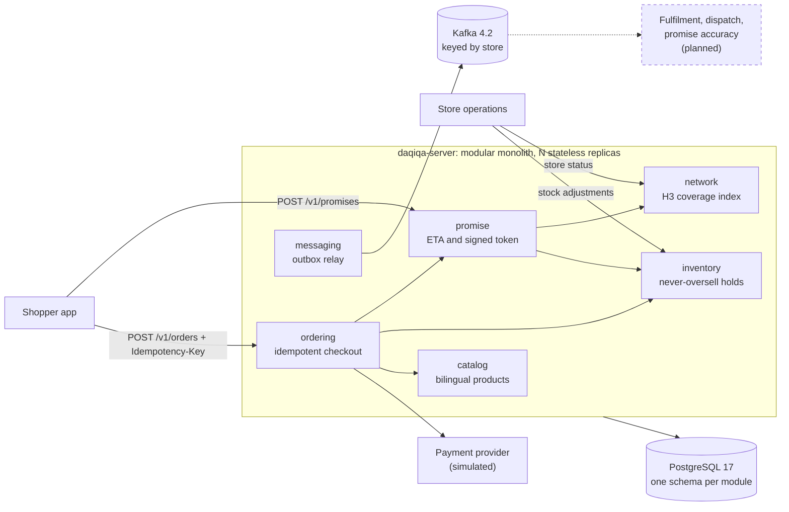

# Daqiqa · دقيقة

**Delivery promises you can trust, in minutes.** Daqiqa (Arabic for "minute") is the engine behind a 15-minute
delivery button, the kind of service Noon Minutes and Amazon Now run in the Gulf. For each basket and address it
calculates how fast the order can really arrive, holds the exact items so they can never be oversold, and turns the
promise into exactly one order.

Java 21 · Spring Boot 4.1 · PostgreSQL 17 · Kafka 4.2 · Uber H3. A modular monolith whose boundaries are enforced by
tests.

> **Status:** the foundation is done (wave 0) and the promise-to-order core is being built now (wave 1). The
> [status table](#status) says exactly what runs today.

## Why this exists

- **A fixed "15 minutes" is a guess.** Delivery time depends on the store's queue, the basket, rider availability and
  distance. Under Daqiqa's v1 model, a quiet store delivers a 3-item basket within 15 minutes up to 3.0 km away in a
  straight line; a busy one, only up to 1.1 km.
- **The last unit is contested.** At peak, many shoppers order the same items from the same store at the same moment.
  Selling one unit twice means a cancellation after payment.
- **Networks drop responses.** Shoppers tap again and apps retry. Without idempotency that is two orders, two holds
  and two charges.

## What makes it interesting

| Hard problem | Mechanism | Status | Read |
|---|---|---|---|
| Never oversell the last unit | Lock the basket's `(store, SKU)` rows in SKU order (`FOR UPDATE`) so baskets cannot deadlock; `CHECK (reserved <= on_hand)` as the last line; holds expire and are swept with `SKIP LOCKED` | In progress | [ADR-0005](docs/adr/0005-never-oversell-inventory-reservations.md), [design](docs/design/inventory.md) |
| "Who can deliver here?" in constant time | H3 resolution-9 cells precomputed per store in an immutable in-memory index; exact distance only for the few candidates | In progress | [ADR-0006](docs/adr/0006-h3-for-coverage.md), [design](docs/design/promise.md) |
| Honour exactly the promise shown | HMAC-SHA256 token binds store, tier, ETA, expiry and a basket hash; verified at checkout without I/O; key ids allow rotation | In progress | [ADR-0007](docs/adr/0007-signed-promise-tokens.md) |
| One tap, one order, one charge | `Idempotency-Key` claimed with a lease and answered from a stored response; reservation idempotent by order id; order id as the payment key | In progress | [ADR-0008](docs/adr/0008-idempotency-keys.md), [design](docs/design/ordering.md) |
| No lost or phantom events | Transactional outbox; one relay per round, elected with a PostgreSQL advisory lock; idempotent producer; keyed by store | In progress | [ADR-0009](docs/adr/0009-transactional-outbox-and-kafka.md), [events](docs/architecture/events.md) |
| Boundaries that cannot erode | ArchUnit rules fail the build when a module reaches into another's internals or a domain imports a framework | Done | [ADR-0003](docs/adr/0003-hexagonal-modules-enforced-by-tests.md), [rules](platform/testing/src/main/java/io/daqiqa/testing/architecture/ArchitectureRules.java) |
| Proof under real concurrency | Integration tests run on real PostgreSQL in every build; for example, 200 threads race for 50 units and exactly 50 win | Harness done; tests in progress | [ADR-0012](docs/adr/0012-testing-strategy.md), [harness](platform/testing/src/main/java/io/daqiqa/testing/postgres/PostgresTestDatabase.java) |

## Architecture



- **Read path:** a promise is one in-memory coverage lookup, one indexed SQL read and an HMAC. No writes.
- **Write path:** checkout is three short transactions around the payment call, each all-or-nothing: the order
  commits with its stock hold, and the confirmation commits with its event and the stored idempotent response.
- **Events:** modules append to an outbox in the same transaction; a relay publishes to Kafka, so Kafka is off the
  request path.

The [architecture guide](docs/architecture/overview.md) covers modules, data ownership, consistency, sequence
diagrams for every key flow, failure modes and the evolution path.

## Status

| Capability | Wave | Status |
|---|---|---|
| Build, CI, formatting, shared kernel (UUIDv7 ids, `Money`, `GeoPoint`), event contracts | 0 | Done |
| Architecture rules (ArchUnit) and the real-PostgreSQL test harness | 0 | Done |
| Catalog: bilingual products, keyset pagination, problem details | 0 | Done |
| Server: health probes, Prometheus metrics, OpenAPI UI, demo catalog | 0 | Done |
| 13 ADRs, conventions, design specifications, OpenAPI contract | 0 | Done |
| Network: dark stores, status, H3 coverage index | 1 | In progress |
| Promise engine: ETA breakdown, tiers, suggestions, signed tokens | 1 | In progress |
| Inventory: never-oversell reservations, expiry sweeper, stock adjustments | 1 | In progress |
| Ordering: idempotent checkout, simulated payment, abandoned-order sweeper | 1 | In progress |
| Messaging: transactional outbox, relay to Kafka | 1 | In progress |
| Fulfilment (picking queue) and dispatch (riders, Redis GEO nearest-rider assignment) | 2 | Planned |
| Live order tracking over server-sent events | 2 | Planned |
| City simulator: Dubai and Riyadh presets, demand curves, accelerated clock, chaos events | 2 | Planned |
| Promise accuracy loop and self-calibrating buffers | 3 | Planned |
| OpenTelemetry tracing, Grafana dashboards, k6 load tests and chaos drills with published results | 3 | Planned |
| Ops console (Angular live map), Arabic and English search (OpenSearch), OAuth2 with Keycloak, Kubernetes and Terraform | 4 | Planned |

Goals and exit criteria for every wave are in the [roadmap](docs/roadmap.md).

## Quickstart

Prerequisites: Java 21 and Docker.

```bash
docker compose -f deploy/compose/compose.yaml up -d    # PostgreSQL 17 and Kafka 4.2
./gradlew :apps:daqiqa-server:bootRun                  # runs migrations and demo data, serves on port 8080
```

Then open <http://localhost:8080/swagger-ui.html>. Also useful: `/actuator/health`, `/actuator/prometheus` and
`/v3/api-docs`.

| Variable | Default | Purpose |
|---|---|---|
| `DAQIQA_DB_URL` | `jdbc:postgresql://localhost:5432/daqiqa` | Database |
| `DAQIQA_DB_USER`, `DAQIQA_DB_PASSWORD` | `daqiqa`, `daqiqa` | Credentials (match the compose file) |
| `DAQIQA_DB_POOL_SIZE` | `20` | Connection pool size per instance |
| `DAQIQA_FLYWAY_LOCATIONS` | `classpath:db/migration,classpath:db/demo` | Drop `classpath:db/demo` to start without demo data |
| `DAQIQA_LOG_FORMAT` | plain text | `ecs` for JSON logs |

**Tests.** `./gradlew build` checks formatting, compiles, and runs unit, property, integration and architecture
tests. Integration tests use real PostgreSQL:

```bash
./gradlew build    # with Docker: Testcontainers starts postgres:17-alpine once per test JVM

# Without Docker: point the build at any PostgreSQL server whose user may create databases.
# Each test JVM creates its own database and drops it on exit.
export DAQIQA_TEST_PG_URL=jdbc:postgresql://localhost:5432/postgres
export DAQIQA_TEST_PG_USER=postgres DAQIQA_TEST_PG_PASSWORD=postgres   # the defaults
./gradlew build
```

## API walkthrough

The contract is [`api/openapi/daqiqa-v1.yaml`](api/openapi/daqiqa-v1.yaml). Money is in minor units (695 = 6.95 AED);
errors are RFC 9457 problem details with a stable `code`. The examples use `curl` and `jq`.

> **What runs today:** step 0, the catalog. Steps 1 to 5 need wave 1 and the Dubai demo stores, which are not loaded
> yet (the demo data holds the catalog only). Response values are illustrative, computed with the v1 model defaults.

**0. Browse a category.** Keyset pagination: `nextCursor` is the last SKU of the page.

```bash
curl -s 'localhost:8080/v1/products?category=DAIRY_EGGS&limit=2' | jq
```

```json
{
  "items": [
    { "sku": "BUTTER-200G", "name": { "en": "Butter 200g", "ar": "زبدة 200 غ" },
      "category": "DAIRY_EGGS", "price": { "amountMinor": 1300, "currency": "AED" } },
    { "sku": "EGGS-12", "name": { "en": "Fresh Eggs × 12", "ar": "بيض طازج × 12" },
      "category": "DAIRY_EGGS", "price": { "amountMinor": 1050, "currency": "AED" } }
  ],
  "nextCursor": "EGGS-12"
}
```

**1. Receive stock at the Dubai Marina store** (store operations). Repeat for `BREAD-ARABIC-6PK` with a delta of 30.

```bash
curl -s localhost:8080/v1/stores/DXB-MARINA/stock/adjustments \
  -H 'Content-Type: application/json' \
  -d '{"sku": "MILK-FULL-1L", "delta": 40, "reason": "RECEIVED"}'
# {"sku":"MILK-FULL-1L","onHand":40,"reserved":0,"available":40}
```

**2. Ask for a promise** for a basket at a Dubai Marina address.

```bash
curl -s localhost:8080/v1/promises -H 'Content-Type: application/json' -d '{
  "location": {"latitude": 25.0772, "longitude": 55.1390},
  "items": [{"sku": "MILK-FULL-1L", "quantity": 2}, {"sku": "BREAD-ARABIC-6PK", "quantity": 1}]
}' | tee promise.json | jq
TOKEN=$(jq -r .offer.token promise.json)
```

```json
{
  "status": "AVAILABLE",
  "offer": {
    "promiseId": "01a0c8fc-b600-7513-9945-2af7c1768eeb",
    "storeId": "DXB-MARINA",
    "tier": "EXPRESS_15",
    "etaMinutes": 11,
    "expiresAt": "2026-09-22T12:01:30Z",
    "token": "v1.k1.MDFhMGM4ZmMtYjYwMC03NTEzLTk5NDUtMmFm…r47_wVZrBPiqVOWwylQtF6oN_l2w87eHVRmgzY7KQ0k",
    "breakdown": { "queueSeconds": 60, "pickSeconds": 69, "riderWaitSeconds": 60, "travelSeconds": 330, "bufferSeconds": 90 }
  },
  "suggestions": []
}
```

609 seconds rounds up to 11 minutes, inside the 15-minute tier. The token is valid for 90 seconds and binds this
store, tier, ETA and basket.

**3. Place the order, then retry it.** The same `Idempotency-Key` returns the same outcome instead of creating a
second order.

```bash
cat > order-request.json <<JSON
{
  "promiseToken": "$TOKEN",
  "customerId": "019ceb9e-93a9-76c4-9863-875e34487ca3",
  "items": [{"sku": "MILK-FULL-1L", "quantity": 2}, {"sku": "BREAD-ARABIC-6PK", "quantity": 1}],
  "deliveryLocation": {"latitude": 25.0772, "longitude": 55.1390},
  "paymentMethod": "CARD"
}
JSON
KEY=$(uuidgen)
for attempt in 1 2; do
  curl -s -o order.json -w "attempt $attempt: HTTP %{http_code}\n" localhost:8080/v1/orders \
    -H 'Content-Type: application/json' -H "Idempotency-Key: $KEY" -d @order-request.json
done
# attempt 1: HTTP 201
# attempt 2: HTTP 201    (replayed: still one order, one hold, one charge)
ORDER_ID=$(jq -r .orderId order.json)
```

**4. Read the order.** It carries the promise it was sold under: `deliverBy` is `placedAt` plus 11 minutes.

```bash
curl -s localhost:8080/v1/orders/$ORDER_ID | jq
```

```json
{
  "orderId": "01a0c8fd-093b-7eeb-be96-e59ce40f9cb1",
  "status": "CONFIRMED",
  "storeId": "DXB-MARINA",
  "customerId": "019ceb9e-93a9-76c4-9863-875e34487ca3",
  "promiseId": "01a0c8fc-b600-7513-9945-2af7c1768eeb",
  "tier": "EXPRESS_15",
  "etaMinutes": 11,
  "placedAt": "2026-09-22T12:00:21.307Z",
  "deliverBy": "2026-09-22T12:11:21.307Z",
  "paymentMethod": "CARD",
  "items": [
    { "sku": "MILK-FULL-1L", "name": { "en": "Full Cream Milk 1L", "ar": "حليب كامل الدسم 1 لتر" }, "quantity": 2,
      "unitPrice": { "amountMinor": 695, "currency": "AED" }, "lineTotal": { "amountMinor": 1390, "currency": "AED" } },
    { "sku": "BREAD-ARABIC-6PK", "name": { "en": "Arabic Bread × 6", "ar": "خبز عربي × 6" }, "quantity": 1,
      "unitPrice": { "amountMinor": 300, "currency": "AED" }, "lineTotal": { "amountMinor": 300, "currency": "AED" } }
  ],
  "total": { "amountMinor": 1690, "currency": "AED" }
}
```

**5. Check the stock.** The confirmed order holds its units: `reserved` rose by 2 and 1. On-hand stock drops when the
order is picked (wave 2).

```bash
curl -s 'localhost:8080/v1/stores/DXB-MARINA/stock?sku=MILK-FULL-1L&sku=BREAD-ARABIC-6PK' | jq
```

```json
{
  "storeId": "DXB-MARINA",
  "items": [
    { "sku": "MILK-FULL-1L", "onHand": 40, "reserved": 2, "available": 38 },
    { "sku": "BREAD-ARABIC-6PK", "onHand": 30, "reserved": 1, "available": 29 }
  ]
}
```

**What checkout can answer**

| Status | `code` | Meaning |
|---|---|---|
| `201` | | Order confirmed. A retry with the same key gets the same response |
| `400` | `IDEMPOTENCY_KEY_MISSING`, `VALIDATION_FAILED` | No key, or an invalid body |
| `402` | `PAYMENT_DECLINED` | Card declined, nothing stays held. The simulated gateway declines amounts above 1,000.00 AED |
| `409` | `OUT_OF_STOCK` | An item sold out after the promise; `shortages` lists what is missing. Ask for a new promise |
| `409` | `IDEMPOTENCY_REQUEST_IN_PROGRESS` | The same key is still being processed. Retry after `Retry-After` |
| `422` | `PROMISE_EXPIRED`, `PROMISE_INVALID`, `PROMISE_CART_MISMATCH` | The token is older than 90 s, altered or not ours, or was issued for another basket |
| `422` | `UNKNOWN_SKU`, `IDEMPOTENCY_KEY_REUSED` | A SKU is not in the catalog; the key was already used for a different request |

```json
{
  "type": "urn:daqiqa:problem:out-of-stock",
  "title": "Out of stock",
  "status": 409,
  "code": "OUT_OF_STOCK",
  "shortages": [{ "sku": "MILK-FULL-1L", "requested": 2, "available": 1 }]
}
```

## Repository map

```text
api/openapi/daqiqa-v1.yaml      HTTP contract (OpenAPI 3.1), written before the code
apps/daqiqa-server/             composition root: every module in one Spring Boot app, plus demo data
build-logic/                    Gradle convention plugins (Java library, Spring module, Boot application)
deploy/compose/compose.yaml     local PostgreSQL 17 and Kafka 4.2
docs/                           product, architecture, ADRs, design notes, conventions, roadmap
gradle/libs.versions.toml       every dependency version, in one place
modules/
  catalog/                      products in English and Arabic; the reference module for conventions
  network/                      dark stores, status, H3 coverage index
  inventory/                    stock levels, reservations that never oversell, adjustments
  promise/                      ETA calculation, tiers, signed promise tokens
  ordering/                     idempotent checkout, simulated payment
platform/
  shared-kernel/                ids (UUIDv7), Money, GeoPoint, LocalizedText, SkuQuantity
  contracts/                    integration events, JDK types only
  messaging/                    transactional outbox and its relay to Kafka
  testing/                      PostgresTestDatabase, ArchitectureRules
AGENTS.md                       working rules for every contributor, human or AI
.github/workflows/ci.yml        build and test on every push to main and every pull request
```

Every module has the same layout (`api`, `domain`, `application`, `adapter`, `config`), keeps its data in its own
PostgreSQL schema and owns one Flyway major version. See the [conventions](docs/engineering/conventions.md).

## Tech stack

| Area | Choice | Version |
|---|---|---|
| Language | Java: records, sealed types, pattern matching, virtual threads | 21 |
| Framework | Spring Boot, with Spring Framework 7.0.9 and Jackson 3.1.5 | 4.1.1 |
| Database | PostgreSQL; plain SQL through `JdbcClient`; Flyway 12.4.0; HikariCP 7.0.2 | 17 |
| Messaging | Apache Kafka in KRaft mode; Spring Kafka 4.1.1, kafka-clients 4.2.1 | 4.2 |
| Geospatial index | Uber H3 | 4.5.0 |
| Identifiers | java-uuid-generator (RFC 9562 UUIDv7) | 5.2.0 |
| Null safety | JSpecify `@NullMarked` on every package | 1.0.0 |
| API | OpenAPI 3.1 contract, springdoc-openapi UI | 3.1.1 |
| Metrics | Micrometer with the Prometheus registry | 1.17.1 |
| Tests | JUnit 6.0.3, AssertJ 3.27.7, Mockito 5.23.0, jqwik 1.10.1, ArchUnit 1.5.0, Testcontainers 2.0.5 | |
| Build | Gradle with convention plugins and a version catalog; Spotless 8.10.2 with palantir-java-format 2.98.0; JaCoCo | 9.7.1 |
| CI | GitHub Actions on Temurin JDK 21 | |

Versions without an entry in [`gradle/libs.versions.toml`](gradle/libs.versions.toml) come from the Spring Boot
4.1.1 BOM.

## Documentation

| Document | Read it for |
|---|---|
| [PR/FAQ](docs/product/PRFAQ.md) | The product, working backwards: press release, tenets, customer and technical FAQ |
| [Architecture guide](docs/architecture/overview.md) | Context, modules, data ownership, consistency model, key flows, failure modes, deployment, evolution |
| [Event catalogue](docs/architecture/events.md) | Envelope, topics, delivery guarantees, versioning, and every event with a JSON example |
| [Quality attributes](docs/architecture/quality-attributes.md) | SLOs and invariants, how each is verified, capacity model |
| [Roadmap](docs/roadmap.md) | Waves 0 to 4: goals, deliverables, exit criteria, status |
| [ADRs](docs/adr/README.md) | 13 decisions, each with its context and the alternatives that lost |
| [Design notes](docs/design/README.md) | Per-module specifications: what each module guarantees and how |
| [Engineering conventions](docs/engineering/conventions.md) | Module anatomy, SQL, HTTP, events, testing, Git |
| [AGENTS.md](AGENTS.md) | The short operational version, including Spring Boot 4 pitfalls |
| [OpenAPI contract](api/openapi/daqiqa-v1.yaml) | Every endpoint, schema and error code |

<details>
<summary>Every ADR and design note</summary>

| ADR | Decision |
|---|---|
| [0001](docs/adr/0001-record-architecture-decisions.md) | Record architecture decisions |
| [0002](docs/adr/0002-modular-monolith-first.md) | Start as a modular monolith; extract services only for measured needs |
| [0003](docs/adr/0003-hexagonal-modules-enforced-by-tests.md) | Hexagonal modules with boundaries enforced by ArchUnit |
| [0004](docs/adr/0004-postgresql-plain-sql-flyway.md) | PostgreSQL, plain SQL via JdbcClient, Flyway with per-module major versions |
| [0005](docs/adr/0005-never-oversell-inventory-reservations.md) | Never oversell: locked check-then-update reservations with expiring holds |
| [0006](docs/adr/0006-h3-for-coverage.md) | H3 hexagonal cells for service areas |
| [0007](docs/adr/0007-signed-promise-tokens.md) | Signed, short-lived promise tokens |
| [0008](docs/adr/0008-idempotency-keys.md) | Idempotency keys on every call that creates a business fact |
| [0009](docs/adr/0009-transactional-outbox-and-kafka.md) | Transactional outbox to Kafka, partitioned by store, single relay leader |
| [0010](docs/adr/0010-uuidv7-identifiers.md) | UUIDv7 identifiers; human-readable store ids |
| [0011](docs/adr/0011-injected-clock.md) | One injected clock |
| [0012](docs/adr/0012-testing-strategy.md) | Testing strategy: real PostgreSQL, properties, concurrency, architecture |
| [0013](docs/adr/0013-java-21-spring-boot-4.md) | Java 21 and Spring Boot 4.1 with virtual threads |

| Design note | Covers |
|---|---|
| [catalog.md](docs/design/catalog.md) | The reference module |
| [inventory.md](docs/design/inventory.md) | Stock, reservations, expiry, adjustments |
| [promise.md](docs/design/promise.md) | Network (stores, coverage) and the promise engine |
| [ordering.md](docs/design/ordering.md) | Checkout, payment, idempotency, and the outbox relay |

</details>

## How this was built

Daqiqa is built by one lead engineer, Asem Dreibati, working with a team of AI coding agents.

- **Contracts first.** The OpenAPI contract, the event records, every module's `api` package and a design
  specification per module were written in wave 0, before any wave 1 code.
- **Parallel worktrees.** Each wave 1 module is built by its own agent in its own git worktree and branch. One schema
  and one Flyway major version per module mean parallel branches cannot collide on tables or migrations.
- **Guardrails, not trust.** ArchUnit rules, real-PostgreSQL concurrency tests, formatting checks and CI decide
  whether a change is acceptable. [AGENTS.md](AGENTS.md) tells every contributor which files are theirs.
- **Independent review.** Changes are reviewed by someone other than their author before they merge.

## License

All rights reserved (portfolio project). Daqiqa is an independent project, not affiliated with noon or Amazon.
