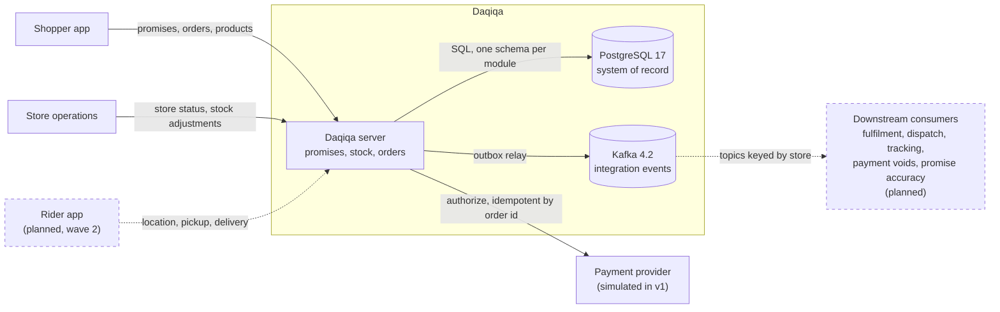
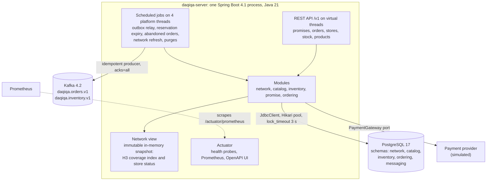
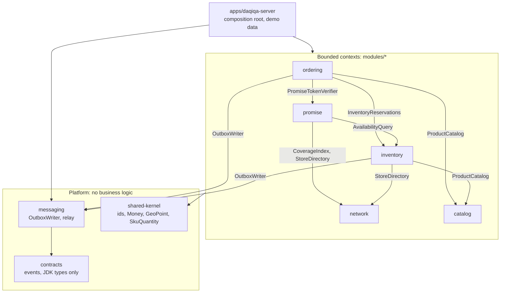
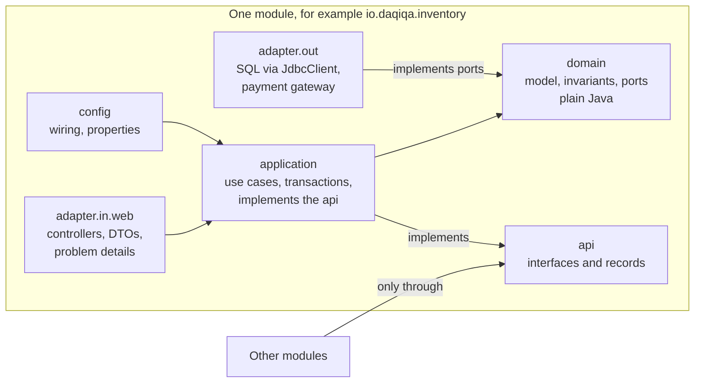
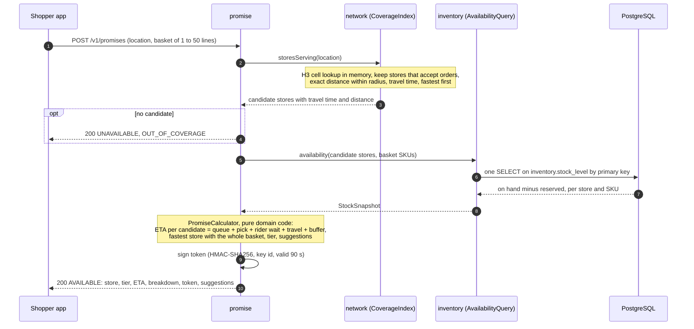
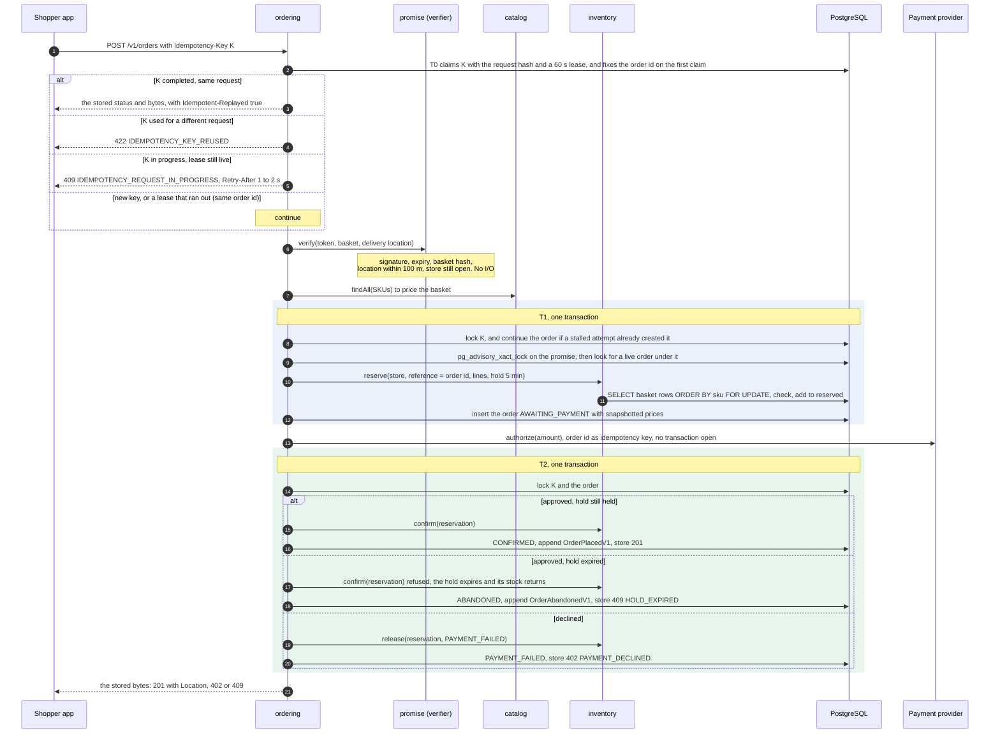
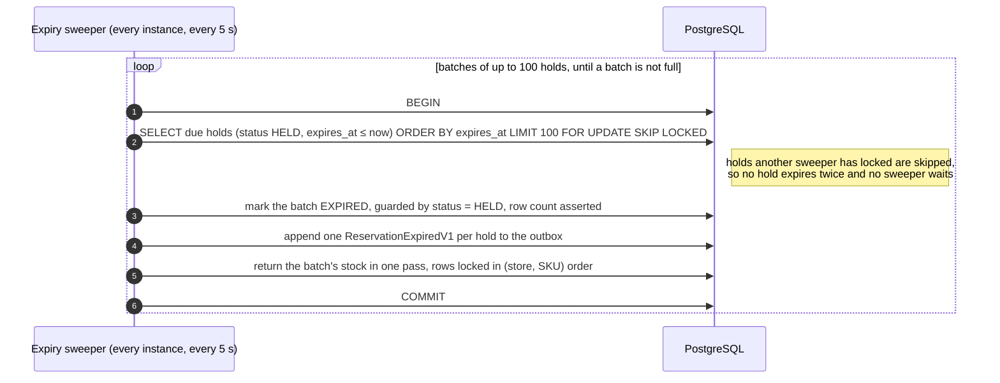
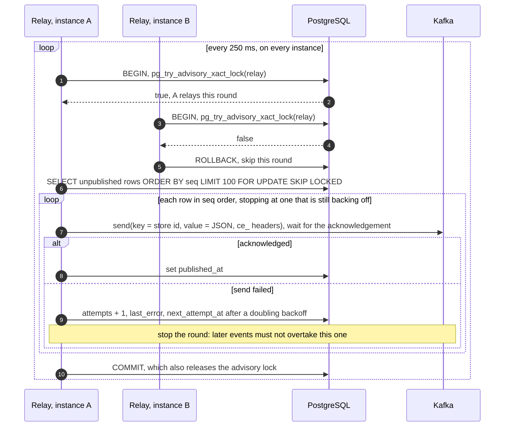
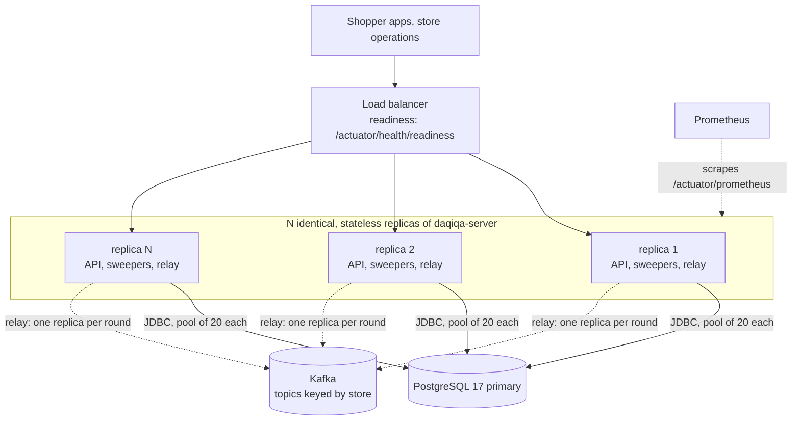

# Architecture guide

Daqiqa does two jobs with opposite needs. On the **read path** it answers "how fast can this basket reach this
address?" many times per second, from memory and one indexed query. On the **write path** it turns one of those
answers into an order: exactly once, without selling a unit twice, and without losing the order or its event
whatever crashes. This guide explains how the system is shaped for both. Each decision is argued in an
[ADR](../adr/README.md); each module's detail, as built, is in its [design note](../design/README.md).

> **Status.** Waves 0 and 1 are done: every module below is built, reviewed, merged and integrated into one running
> server, with 629 tests passing on real PostgreSQL and an end-to-end test over HTTP. Later work is marked
> *planned*. See the [roadmap](../roadmap.md).

## Contents

1. [System context](#1-system-context)
2. [Containers](#2-containers)
3. [Modules and allowed dependencies](#3-modules-and-allowed-dependencies)
4. [Module anatomy and how it is enforced](#4-module-anatomy-and-how-it-is-enforced)
5. [Data ownership](#5-data-ownership)
6. [Consistency model](#6-consistency-model)
7. [Key flows](#7-key-flows)
8. [Failure modes](#8-failure-modes)
9. [Deployment](#9-deployment)
10. [Evolution path](#10-evolution-path)
11. [Review outcomes and open gaps](#11-review-outcomes-and-open-gaps)

## 1. System context



| Actor or system | Interaction | Interface | Status |
|---|---|---|---|
| Shopper app | Asks for a promise, places the order, reads it back; browses products | `POST /v1/promises`, `POST /v1/orders`, `GET /v1/orders/{orderId}`, `GET /v1/products` | Built |
| Store operations | Sets store status (open, busy, paused, closed); records deliveries, damage and counts | `PUT /v1/stores/{storeId}/status`, `POST /v1/stores/{storeId}/stock/adjustments` | Built |
| Rider app | Reports location, pickup and delivery | Not yet specified | Planned (wave 2) |
| Payment provider | Authorizes card payments, deduplicating on the order id | `PaymentGateway` port; `SimulatedPaymentGateway` declines amounts above 1,000.00 AED | Built (simulated) |
| PostgreSQL | System of record for every module | JDBC (`JdbcClient`), Flyway migrations | Built |
| Kafka | Carries integration events to consumers | Transactional outbox and relay ([events](events.md)) | Built |
| Downstream consumers | Fulfilment, dispatch, tracking, the payments void job, promise accuracy, analytics | Kafka topics `daqiqa.orders.v1`, `daqiqa.inventory.v1` | Planned |

The HTTP contract is [`api/openapi/daqiqa-v1.yaml`](../../api/openapi/daqiqa-v1.yaml): written before the code,
errors as RFC 9457 problem details with a stable `code`, `Idempotency-Key` on the call that creates orders.

## 2. Containers



| Container | Technology | Responsibility | State |
|---|---|---|---|
| `daqiqa-server` | Java 21, Spring Boot 4.1.1, Spring MVC | All five bounded contexts, the HTTP API, scheduled jobs | Stateless. The network view is a cache of PostgreSQL data, built at startup and reconciled every 30 s |
| PostgreSQL | 17 | Stores, products, stock, reservations, orders, idempotency keys, outbox | Durable, one schema per module |
| Kafka | 4.2, KRaft mode | Integration events for downstream consumers | Durable log, off the request path |

Requests run on virtual threads (`spring.threads.virtual.enabled=true`), so plain blocking JDBC never exhausts a thread
pool ([ADR-0013](../adr/0013-java-21-spring-boot-4.md)). Scheduled jobs run on a small pool of platform threads
instead, so that a relay waiting on an unreachable broker cannot delay the sweeper that returns expired stock
([ADR-0014](../adr/0014-background-jobs-on-a-platform-thread-scheduler.md)). The database connection pool (20 per
instance by default) is the real concurrency limit, the capacity model shows it is far from binding
([quality attributes](quality-attributes.md#capacity-model)), and `lock_timeout = '3s'` on every connection bounds how
long any request can wait for a row lock.

## 3. Modules and allowed dependencies

Five bounded contexts, deployed together as one application, built as if they were separate services
([ADR-0002](../adr/0002-modular-monolith-first.md)). Each edge below is a Gradle dependency, labelled with the main
interface used across it.



| Module | Owns | Public API (`api` package) | Status |
|---|---|---|---|
| network | Dark stores, their status, service radius; the coverage index | `StoreDirectory` and `CoverageIndex` (both answered from memory), `DarkStore`, `StoreCoverage`, `StoreStatus` | Built |
| catalog | Products, bilingual names, prices | `ProductCatalog`, `Product` | Built (reference module) |
| inventory | Stock levels, reservations, adjustments | `AvailabilityQuery` (fast read), `InventoryReservations` (strict write), `StockSnapshot`, `ReservationRequest`, `ReservationResult`, `Shortage`, `ReleaseReason`, `ReservationNoLongerHeldException` | Built |
| promise | ETA calculation, tiers, suggestions, tokens | `PromiseTokenVerifier` (`verify(token, lines, deliveryLocation)`), `VerifiedPromise`, `DeliveryTier`, `InvalidPromiseException` | Built |
| ordering | Orders, checkout, idempotency keys | Empty on purpose: driven over HTTP, speaks to others through `OrderPlacedV1` and `OrderAbandonedV1` | Built |

Why the arrows point this way:

- **Ordering sits on top** because checkout orchestrates the others. Nothing depends on ordering, so its `api`
  package is empty and it can change freely.
- **Inventory offers two interfaces for two questions.** `AvailabilityQuery` is a lock-free read used to *promise*;
  `InventoryReservations` is the locking write used to *guarantee*. Keeping them apart stops the hot path from
  paying for guarantees it does not give.
- **Promise reads store status from network at checkout**, from memory, to refuse tokens of a store that stopped
  taking orders.
- **Inventory depends on network and catalog only to validate requests**: the store must exist (stock reads and
  adjustments) and the SKU must exist (adjustments).
- **Platform code never depends on a module.** Event records in `contracts` use JDK types only, so events outlive
  any internal refactoring. `platform/testing` (PostgreSQL test databases, architecture rules) is used from test code
  only.

## 4. Module anatomy and how it is enforced

Every module has the same hexagonal shape; [catalog](../../modules/catalog/src/main/java/io/daqiqa/catalog) is the
reference implementation.



The domain holds the rules that matter: the reservation state machine, shortage computation, the ETA calculation,
the order state machine. It is plain Java, so those rules are unit- and property-tested in milliseconds without
Spring or a database ([ADR-0003](../adr/0003-hexagonal-modules-enforced-by-tests.md)).

Boundaries that exist only in a diagram erode. These are checked on every build:

| Rule | Enforced by |
|---|---|
| The domain uses no framework: no Spring, Jakarta, Jackson, JDBC, Flyway, Kafka or Micrometer | `ArchitectureRules.domainIsFrameworkFree`, in each module's `ArchitectureTest` |
| Layers depend inwards, and the `api` package never exposes domain types | `ArchitectureRules.layersAreRespected` (layered architecture over `api`, `domain`, `application`, `adapter`, `config`) |
| Other modules reach a module only through its `api` package | `ArchitectureRules.modulesTalkOnlyThroughTheirApis`, in the server's `ArchitectureTest` over the whole codebase |
| No dependency cycles between modules or platform packages | `ArchitectureRules.noCyclesBetweenModules` |
| A module can use only the modules its build file declares | Gradle project dependencies, at compile time |
| Events are versioned records built from JDK types only | `EventContractTest` |
| One code style | Spotless with palantir-java-format, part of `./gradlew build` |
| Migrations from parallel branches never collide | One Flyway major version per module, by construction |

The rules live in [`ArchitectureRules`](../../platform/testing/src/main/java/io/daqiqa/testing/architecture/ArchitectureRules.java).
A violation is a red build with an explanation, not a code-review debate.

## 5. Data ownership

PostgreSQL is the system of record, with one schema per module. A module never reads or writes another module's
schema: no cross-schema joins, no cross-schema foreign keys. Identifiers cross boundaries as plain values (an order
stores the `store_id` from its verified token and the SKUs priced by the catalog), and facts cross boundaries as
events. Each module owns one Flyway major version, so modules add migrations in parallel without collisions
([ADR-0004](../adr/0004-postgresql-plain-sql-flyway.md)).

| Schema | Owner | Tables | Flyway major |
|---|---|---|---|
| `network` | network | `dark_store` (with a `version` that orders status changes) | 1 |
| `catalog` | catalog | `product` | 2 |
| `inventory` | inventory | `stock_level`, `reservation`, `reservation_line`, `stock_adjustment` (append-only, enforced by a trigger) | 3 |
| none | promise | Stateless: a promise lives in its signed token, not in a row. Major 4 is reserved | 4 |
| `ordering` | ordering | `customer_order`, `order_line`, `idempotency_key` | 5 |
| `messaging` | messaging | `outbox_event` | 6 |
| seed data | server app | Dubai demo data: 12 stores, 52 products, stock for every product at every store | 9 |

The constraints and indexes that carry the guarantees:

| Constraint or index | Table | Why |
|---|---|---|
| `CHECK (reserved <= on_hand)`, plus non-negative checks | `inventory.stock_level` | The database refuses an oversell even if application code is wrong |
| Partial unique index on `reference` where status is `HELD` or `CONFIRMED` | `inventory.reservation` | Reserving twice for one order is impossible, not merely avoided |
| Partial index on `expires_at` where status is `HELD` | `inventory.reservation` | The expiry sweeper scans only live holds |
| Store ids and SKUs in `COLLATE "C"` | `network`, `inventory` | Lock order and listings are byte order on every server; an OS collation upgrade cannot reorder the indexes |
| Primary key `(customer_id, key)` | `ordering.idempotency_key` | One claim per key and customer |
| Partial unique index on `promise_id` where status is `AWAITING_PAYMENT` or `CONFIRMED` | `ordering.customer_order` | A promise converts to at most one live order |
| Partial index on `placed_at` where status is `AWAITING_PAYMENT` | `ordering.customer_order` | The abandoned-order sweeper scans only waiting orders |
| Partial index on `seq` where `published_at IS NULL` | `messaging.outbox_event` | The relay reads the backlog, never the history |
| Index `(category, sku)`; `CHECK (price_minor > 0)`; SKU format check | `catalog.product` | Browsing a category is an index walk with no sort; invalid products cannot exist |

## 6. Consistency model

Strict where stock and money change hands, eventual where the data is an offer or a notification.

| Data or decision | Consistency | Mechanism | Why |
|---|---|---|---|
| Reserving stock | Strong, serialised per `(store, SKU)` row | Rows locked in (store, SKU) order with `FOR UPDATE`; guarded updates; `CHECK` constraint | A unit sold twice cannot be fixed with an apology |
| Checkout steps | Atomic per step: T1 commits the order with its reservation; T2 commits the confirmation with its event and the stored response | The reservation joins the caller's transaction; the outbox row and the idempotent response are written in the transaction that changes the state | Every step leaves a valid state, and the only intermediate one (`AWAITING_PAYMENT` with a hold) expires on its own. Keeping this in one database is the main reason for a modular monolith |
| Idempotency claim | Strong, one row per `(customer, key)` | Own short transaction with a lease; every later transaction of the checkout locks the key row first | One request at a time processes a key, and a stalled attempt cannot overwrite a newer outcome |
| Promise to order | At most one live order per promise | Per-promise advisory lock, then the partial unique index | A promise is one offer, not a coupon |
| Availability shown in a promise | Latest committed value, read without locks; may be outdated a moment later | One indexed `SELECT` | A promise is an offer. Checkout re-checks under lock |
| Network view (coverage, status) | Immutable snapshot, replaced atomically | Map behind an `AtomicReference`; changes applied in version order | Lock-free reads on the hottest path |
| Store status across replicas | Immediate on the instance that changed it; other instances within the 30 s reconciliation | In-memory snapshot, reconciled from PostgreSQL; a `StoreStatusChangedV1` event is an [open gap](#still-open) | Bounded staleness, visible in the docs and the metrics |
| Promise | Stateless and verifiable | HMAC-signed token | No write on the hot path, nothing to keep in sync |
| Downstream consumers | Eventual: at-least-once, ordered per store, sub-second in the normal case | Transactional outbox, relay every 250 ms | Kafka stays off the request path; no dual write |
| Prices on an order | Snapshotted at checkout | Copied into the order lines | A later price change never alters a placed order |

## 7. Key flows

### 7.1 Promise

The hot path: no writes, one database round trip, everything else in memory.



**Coverage** ([ADR-0006](../adr/0006-h3-for-coverage.md)). Every store's service area is precomputed as the H3
resolution-9 cells (about 0.1 km² each) whose centres lie within its radius plus one cell's circumradius, so a customer
inside the radius is never missed because their cell's centre falls outside it. Measured in Dubai, a 3 km store
indexes 358 cells in 1.4 ms. A lookup converts the point to its cell, reads the candidates, and applies the exact rules
to those few stores only (accepts orders, great-circle distance within the radius), so the answer is exact. Store
status lives in the same snapshot, so a pause takes effect at once on that instance.

**ETA** ([promise.md](../design/promise.md)). The README walkthrough's basket (3 units) at a Dubai Marina address, from
`DXB-MARINA` 390 m away: queue 60 s + pick 69 s (45 s + 8 s per unit) + rider wait 60 s + travel 133 s (389.6 m × 1.3
road factor ÷ 7 m/s + 60 s handoff, rounded up to the second) + buffer 90 s = 412 s, rounded up to **7 minutes**, tier
`EXPRESS_15`. The calculator ranks stores that can supply the whole basket to the second (ties: shorter distance, then
store id) and maps the ETA to the fastest tier that covers it (`EXPRESS_15`, `STANDARD_30`, `EXTENDED_60`). For every
set of items some candidate lacks, it promises the rest of the basket again and suggests dropping those items when
that arrives at least a minute sooner (at most two suggestions). In the walkthrough, milk and chocolate milk come
from `DXB-JLT` in 9 minutes; dropping the chocolate, which Marina lacks, gets 7 minutes from Marina. "We cannot
deliver this" is a normal `200` answer with a reason (`OUT_OF_COVERAGE`, `OUT_OF_STOCK`, `NO_CAPACITY`), not an
error.

**Token** ([ADR-0007](../adr/0007-signed-promise-tokens.md)). The offer is signed so that checkout can honour exactly
what the customer saw without storing it. The walkthrough's real token, signed with the development key `dev`:

```text
v1.dev.<base64url(payload)>.<base64url(HMAC-SHA256 over "v1.dev.<base64url(payload)>" with key dev)>

payload, decoded:
01a0c9d1-e1a3-7467-a717-b38a42e03361|DXB-MARINA|EXPRESS_15|7|1790092370|1790092460|Sb48CH6MP-_wLWqUh08jOgL-qV7XQtoy-5EvmXCd-zw|25077200|55139000
promise id                          |store     |tier      |ETA|issued at|expires at|SHA-256 of "BREAD-ARABIC-6PK:1,MILK-FULL-1L:2"|latitude and longitude in micro-degrees
```

Checkout runs the checks in this order; each failure is stored under the idempotency key and replayed like any other
answer:

| Check at checkout | Failure reason | Answer |
|---|---|---|
| Format and a known key id (`kid`), then the signature, compared in constant time | `MALFORMED`, `TAMPERED` | `422 PROMISE_INVALID` |
| Now (injected clock) before `expiresAt` | `EXPIRED` | `422 PROMISE_EXPIRED` |
| Hash of the merged, SKU-sorted basket | `CART_MISMATCH` | `422 PROMISE_CART_MISMATCH` |
| Delivery location within 100 m of the promised one | `LOCATION_MISMATCH` | `422 PROMISE_LOCATION_MISMATCH` |
| The store still accepts orders (`BUSY` does) | `STORE_UNAVAILABLE` | `409 STORE_UNAVAILABLE` |

### 7.2 Checkout

The write path. A key claim, then two short transactions around one external call; the payment call never runs
inside a transaction or while holding a row lock.



- **Every refusal is stored in T1**, under the key lock: a promise that fails verification (`422 PROMISE_*`), an
  unknown SKU (`422 UNKNOWN_SKU`), a store that stopped taking orders (`409 STORE_UNAVAILABLE`), a promise already
  used by a live order (`409 PROMISE_ALREADY_USED`) and a basket the store can no longer cover (`409 OUT_OF_STOCK`,
  with `shortages`). A stalled attempt can therefore never store an answer that contradicts the order.
- **One promise, one live order.** The advisory lock on the promise is taken before any stock is held, so a racing
  second checkout waits for the first and is then told `PROMISE_ALREADY_USED`, never `OUT_OF_STOCK`. The partial
  unique index on live orders' promise ids is the second line: if it fires, T1 rolls back with its stock hold and a new
  T1 stores the refusal. An order whose payment failed or that was abandoned frees the promise.
- **Cash on delivery** needs no payment call: T1 also confirms the reservation, inserts the order as `CONFIRMED`,
  appends `OrderPlacedV1` and stores the `201`.
- **Payment slower than the hold**: `confirm` expires the hold, returns the stock and throws
  `ReservationNoLongerHeldException` without marking T2 rollback-only, so ordering abandons the order in T2. If T2
  fails to commit anyway, a separate T3 abandons it; if the sweeper abandoned the order first, T2 finds it abandoned.
  Each path answers `409 HOLD_EXPIRED`, and every abandonment appends `OrderAbandonedV1`, which tells a future void job
  that an authorization may exist.
- **Retries at every layer**: the key deduplicates the request, the order id fixed at the first claim makes the
  reservation and the payment idempotent, and a retry that takes over an expired lease continues the same order. An
  unexpected failure (5xx) ends the lease without deleting the key, so an immediate retry continues too
  ([ADR-0008](../adr/0008-idempotency-keys.md)).
- **Answers are bytes.** Each response is rendered once, stored as text in the transaction that settles the order, and
  sent from storage the first time too, so a replay is identical by construction. Timestamps are truncated to
  milliseconds, so the `201` body and a later `GET` match exactly.
- **Prices** come from the catalog at checkout and are copied into the order lines. The token guarantees the time, not
  the price.

### 7.3 Reservation expiry

Holds return to sale on their own, so a crash or an abandoned payment can never lock stock forever.



- **Statuses, then events, then stock.** The status update touches only reservation rows the batch already holds, the
  outbox is append-only, and the stock rows every checkout needs are locked last, for the final statements only.
- **One sorted pass per batch.** Returning each reservation's stock in turn could lock `B` before `A` and deadlock
  with a basket `[A, B]`; summing the batch per (store, SKU) and locking in that order cannot.
- **One bad hold cannot stall the rest.** A failing batch is retried one hold per transaction; a hold that still fails
  is counted (`daqiqa.inventory.expiry.failures`) and left held, and the `daqiqa.inventory.expiry.oldest.overdue`
  gauge keeps rising until someone looks.
- **The sweeper is a safety net.** A `confirm` or a retried `reserve` that meets a hold past its `expiresAt` expires it
  itself, so a late confirmation never wins because the sweeper has not run yet.
- **Ordering sweeps too.** Every 30 s, ordering abandons `AWAITING_PAYMENT` orders older than the hold, each in its own
  transaction with `FOR UPDATE SKIP LOCKED`, through the same abandonment path that appends `OrderAbandonedV1`.

### 7.4 Outbox relay

How committed events reach Kafka without a dual write ([ADR-0009](../adr/0009-transactional-outbox-and-kafka.md)).



- **Leader election without infrastructure.** `pg_try_advisory_xact_lock` never waits: the winner relays, the others
  skip the round. The lock is scoped to the transaction, so it is released when PostgreSQL ends a crashed relay's
  session, and another instance relays in the next round. In production, `idle_in_transaction_session_timeout` bounds
  how long a hung (rather than crashed) relay can keep it.
- **Durable by default.** Kafka is the default publisher, and it refuses to start unless the producer is explicitly
  durable (`acks=all`, `enable.idempotence=true`, at most five requests in flight, `max.block.ms` within the relay's
  send timeout). The `logging` publisher is an opt-in for runs without a broker.
- **A failing event backs off**, from 1 s doubling to 5 min, and nothing after it is published meanwhile. The relay
  runs on its own scheduler thread, so a stuck broker never delays reservation expiry.
- **At-least-once.** A relay that dies after the broker acknowledged and before `COMMIT` sends those rows again next
  round. Consumers deduplicate on the event id; the [event catalogue](events.md#rules-for-consumers) has the rules.
- **Why `published_at IS NULL` and not a cursor.** `seq` is assigned at insert, not at commit; a cursor past the
  highest published `seq` would skip a row that committed late.

## 8. Failure modes

| Failure | What happens | Mitigation | Tested by |
|---|---|---|---|
| Instance crashes mid-checkout | Before T1 commits: nothing is held, no order exists. Between T1 and T2: the order waits in `AWAITING_PAYMENT` with its stock held. After T2: the order is settled and its answer stored | The order id was fixed at the first claim, so the client's retry after the 60 s lease continues the same order: it authorizes again (the provider deduplicates) while the hold runs, or abandons the order with `409 HOLD_EXPIRED` once it has run out. Without a retry, the sweepers close the order and return the stock. After T2, a retry replays the stored answer | `CheckoutServiceTest` (resumption after a crash), `StalledCheckoutTest`, sweeper tests. Chaos drill (wave 3) |
| Duplicate request | Same key and body: the stored bytes are replayed with `Idempotent-Replayed: true`. Same key, different body: `422 IDEMPOTENCY_KEY_REUSED`. First still running: `409 IDEMPOTENCY_REQUEST_IN_PROGRESS` with `Retry-After` of 1 to 2 s | One claim per `(customer_id, key)`; every checkout transaction locks the key row first; reservation and payment idempotent by the order id | `CheckoutConcurrencyTest` (20 identical requests), `CheckoutHttpTest` (byte-identical replays), `CheckoutEndToEndTest` |
| Two keys, one promise | The first checkout wins; the others get `409 PROMISE_ALREADY_USED` and hold no stock | A per-promise advisory lock before any stock is held; the partial unique index as the second line | `CheckoutConcurrencyTest` (8 keys racing) |
| Payment provider slow or down | The order waits with its stock held; no transaction or row lock is open during the call | An unexpected failure ends the lease without deleting the key, so an immediate retry continues the same order; the provider deduplicates on the order id. A payment that outlasts the hold ends in `409 HOLD_EXPIRED`, and `OrderAbandonedV1` flags the authorization for voiding (the void job is an [open gap](#still-open)) | `CheckoutServiceTest` (payment outlives the hold in T2, in T3, on a retry, after the sweeper) |
| Kafka down | Checkouts continue. Events accumulate in `messaging.outbox_event`; the first failing event backs off from 1 s to 5 min and the events after it wait | Events are already committed with their state and drain in order when Kafka returns. `daqiqa.outbox.backlog` and `daqiqa.outbox.failures` show it; the relay's scheduler thread is separate, so holds keep expiring | `OutboxRelayTest` (stop, backoff), `OutboxToKafkaTest`. Chaos drill (wave 3) |
| Store paused | New promises avoid the store at once on the instance that handled the change; a checkout under an earlier token answers `409 STORE_UNAVAILABLE` | Other replicas see the change within the 30 s reconciliation until status changes travel as events ([open gap](#still-open)) | `CheckoutEndToEndTest` (paused store), `CheckoutPromiseVerifierTest`, `StoreStatusChangeIntegrationTest` |
| Address changed after the quote | Checkout answers `422 PROMISE_LOCATION_MISMATCH` and the app asks for a new promise | The token signs the promised location; the tolerance is 100 m | `CheckoutEndToEndTest`, `CheckoutPromiseVerifierTest` (±1 cm around the boundary) |
| Stock race on the last units | Two shoppers hold valid promises for the last unit. The first checkout reserves it; the second gets `409 OUT_OF_STOCK` with `shortages` | Only reservations lock, in (store, SKU) order, and the `CHECK` constraint refuses any oversell. A checkout stuck behind a hot row fails after 3 s (`lock_timeout`) and is retried with its key | Inventory concurrency tests (200 threads on 50 units, opposite-order baskets) |
| Instance lost | The load balancer stops routing to it; its in-flight requests fail | No state lives only in one instance: the network view is rebuilt from PostgreSQL, claims expire after their lease, holds after 5 minutes, the relay lock is released with the dead transaction, and sweepers run everywhere. Clients retry with the same key | Chaos drill (wave 3) |
| PostgreSQL unavailable | Promises and checkouts fail with `5xx` | Every state change is one transaction, so nothing is half-written; clients retry with the same key. Production needs a highly available PostgreSQL (wave 4) | Chaos drill (wave 3) |

## 9. Deployment



- **Every replica is identical.** Each serves HTTP, runs the sweepers and competes for the relay lock on its own pool
  of scheduler threads (`daqiqa.scheduler.pool-size`, default 4). There is no special "worker" instance to lose:
  `SKIP LOCKED` spreads the sweeps, the advisory lock picks one relay per round.
- **Configuration comes from the environment**: `DAQIQA_DB_URL`, `DAQIQA_DB_USER`, `DAQIQA_DB_PASSWORD`,
  `DAQIQA_DB_POOL_SIZE`, `DAQIQA_KAFKA_BOOTSTRAP_SERVERS`, `DAQIQA_EVENT_PUBLISHER` (`kafka` by default),
  `DAQIQA_FLYWAY_LOCATIONS` and `DAQIQA_LOG_FORMAT=ecs` for JSON logs.
- **Signing keys come from a secret store** as `daqiqa.promise.token.keys.<id>`, with `active-key-id` naming the one
  that signs; without an active key the server does not start. The published development key lives in the `dev`
  profile (`application-dev.yaml`, which `bootRun` activates) and nowhere else: configured under any id while that
  profile is inactive, it stops the server at startup (`DevelopmentKeyGuard`). The demo data (`classpath:db/demo`) is
  part of the same profile.
- **Every connection sets `lock_timeout = '3s'`**, so a request never waits longer than that for a row lock. Jobs pick
  their work with `SKIP LOCKED` and try-locks, and cap their own row-lock waits at 500 ms (`SET LOCAL lock_timeout`),
  counting a timeout as contention and retrying in the next round.
- **Rolling restarts are safe.** `server.shutdown=graceful` finishes in-flight requests; liveness and readiness
  probes are exposed under `/actuator/health`.
- **Schema changes run at startup** through Flyway (`outOfOrder=true`, per-module majors). A merged migration is
  never edited; a change is a new migration.
- **Locally**, [`deploy/compose/compose.yaml`](../../deploy/compose/compose.yaml) runs PostgreSQL 17 and a single
  Kafka 4.2 broker in KRaft mode with 12 partitions per topic by default. The Kubernetes and Terraform deployment is
  planned for wave 4.

## 10. Evolution path

The module boundaries exist so that a module can leave the monolith when a measurement says so, not before
([ADR-0002](../adr/0002-modular-monolith-first.md)). The likely order:

1. **Dispatch and tracking, first (wave 2).** Rider positions arrive at about 200 writes per second per city under the
   [capacity model's](quality-attributes.md#capacity-model) assumptions and are short-lived, a different profile from
   orders; they live in Redis GEO, not PostgreSQL. Dispatch talks to the core only through events (`OrderPlacedV1` in,
   delivery events out), so running it as a separate service is a deployment change, not a contract change.
2. **The promise read path, if promise traffic dominates.** The promise module has no schema and no writes. It can run
   on dedicated replicas and read availability from a replica or a read model fed by stock events, behind the same
   `AvailabilityQuery` interface.
3. **Inventory, only on a measured need.** Holds already expire on their own
   ([ADR-0005](../adr/0005-never-oversell-inventory-reservations.md)), so turning the in-process `reserve` into a
   network call turns checkout into a saga (reserve, pay, confirm; expiry is the compensation) without changing a
   business rule.
4. **The relay, when throughput becomes the constraint.** Pipelining each batch's sends (the idempotent producer keeps
   per-partition order), or Debezium CDC reading the same `outbox_event` table
   ([ADR-0009](../adr/0009-transactional-outbox-and-kafka.md)).
5. **Cells per region.** A basket ships from one store and no transaction spans two stores, so a city or region can
   run as an independent cell (replicas, database, Kafka) with requests routed by city. Cross-city views, such as a
   customer's order history, would then need their own read model.

## 11. Review outcomes and open gaps

### Settled in the wave-1 review

Each question this guide raised before wave 1 merged is now answered in code and tests:

1. **The order id is fixed at the first key claim**, so a retry that takes over a lease continues the same order
   instead of creating a second order, hold and authorization ([ADR-0008](../adr/0008-idempotency-keys.md),
   [ordering.md](../design/ordering.md)).
2. **A late confirm does not roll back T2**: inventory's `confirm` is `@Transactional(noRollbackFor = ...)`, and
   ordering catches the exception inside T2, with T3 as a fallback ([inventory.md](../design/inventory.md),
   [ordering.md](../design/ordering.md)).
3. **Tokens bind the delivery location** (100 m tolerance, `PROMISE_LOCATION_MISMATCH`) **and the store status**
   (`STORE_UNAVAILABLE`) ([ADR-0007](../adr/0007-signed-promise-tokens.md), [promise.md](../design/promise.md)).
4. **"Payment outlasted the hold" is a named outcome**, `409 HOLD_EXPIRED`, and every abandonment publishes
   `OrderAbandonedV1` ([ordering.md](../design/ordering.md), [events](events.md#orderabandonedv1)).
5. **Coverage indexes the radius plus one cell circumradius**, so no customer at the edge of a service area is missed
   ([ADR-0006](../adr/0006-h3-for-coverage.md)).
6. **Demo stores and stock exist**, and the [README walkthrough](../../README.md#api-walkthrough) runs end to end on
   them.
7. **`.gitignore` and `.jqwik-database` are fixed**: `adapter/out` packages are committed and the jqwik database is
   untracked.

### Still open

Tracked in the roadmap's [known gaps](../roadmap.md#known-gaps-not-yet-scheduled):

- **A payments void job** consuming `OrderAbandonedV1`; `PaymentGateway` has no void operation yet.
- **Idempotent stock adjustments**: a retried adjustment counts twice.
- **A `StoreStatusChangedV1` event**, so a status change reaches every replica at once instead of within 30 s.
- **Pruning ended reservations**, which are kept forever today.
- **Authentication**: the customer id comes from the request body, and orders have no ownership check.
- **Relay throughput**: one event per acknowledgement.
