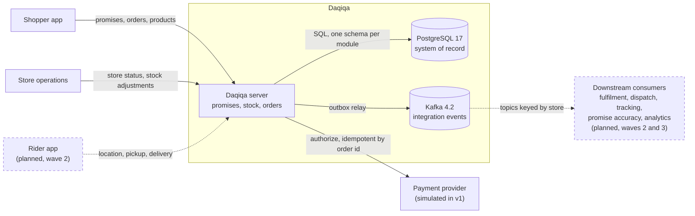
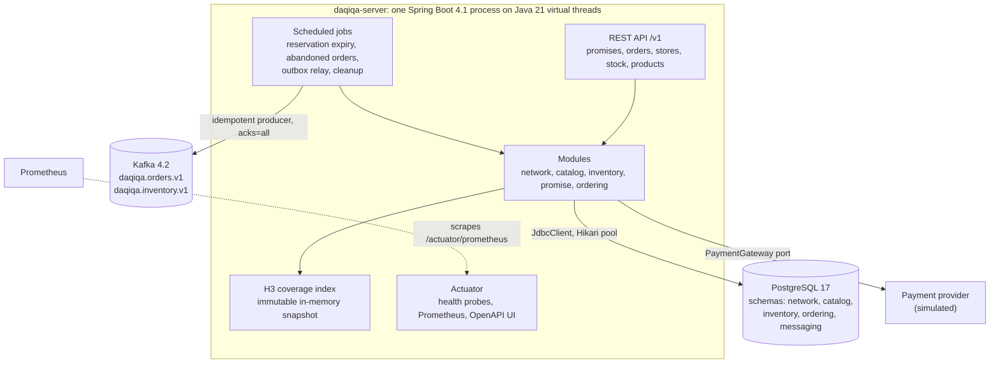
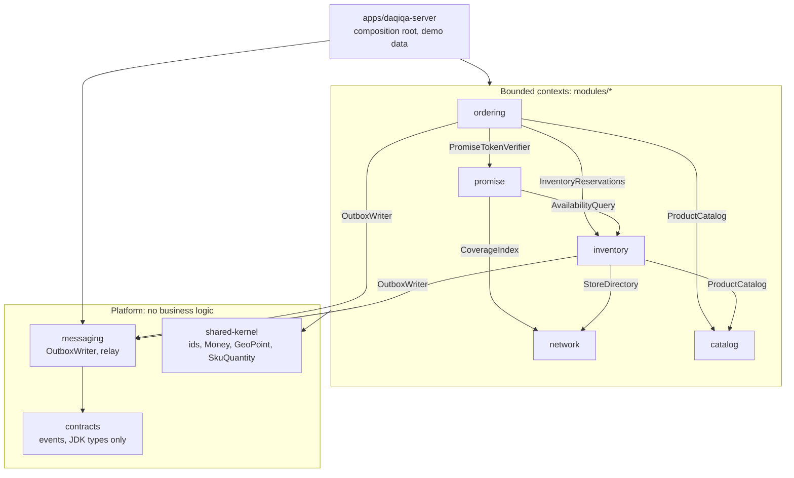
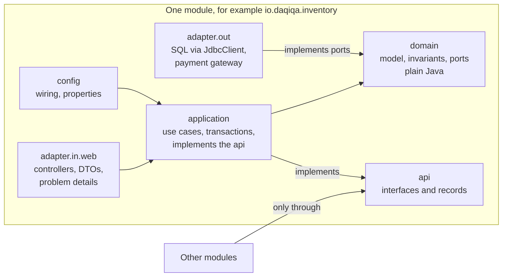
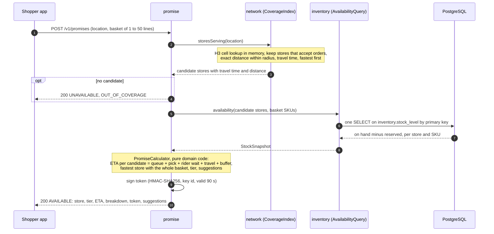
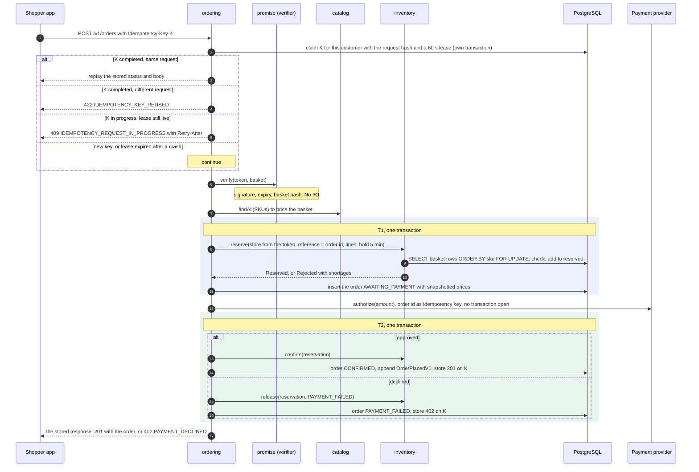
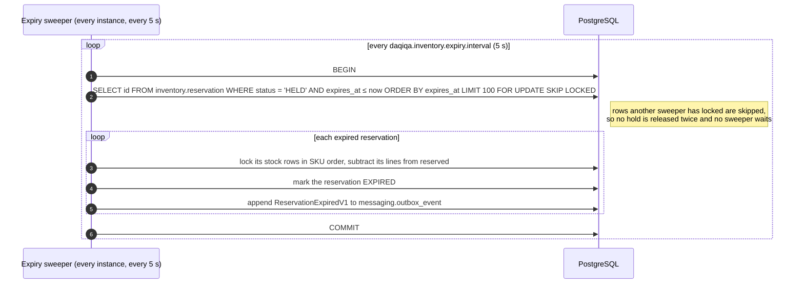
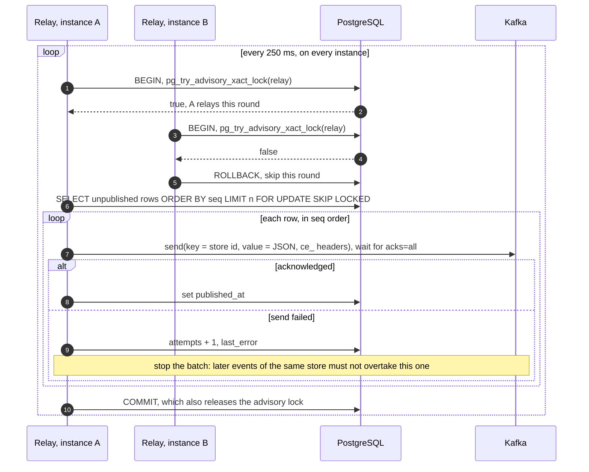
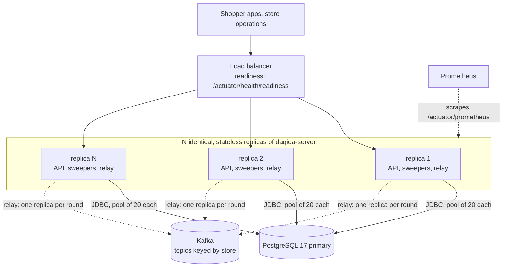

# Architecture guide

Daqiqa does two jobs with opposite needs. On the **read path** it answers "how fast can this basket reach this
address?" many times per second, from memory and one indexed query. On the **write path** it turns one of those
answers into an order: exactly once, without selling a unit twice, and without losing the order or its event
whatever crashes. This guide explains how the system is shaped for both. Each decision is argued in an
[ADR](../adr/README.md); each module's detail is in its [design note](../design/README.md).

> **Status.** Wave 0 (foundation) is done. Wave 1 (network, promise, inventory, ordering, messaging) is being built
> now, against the specifications this guide describes. Later work is marked *planned*. See the
> [roadmap](../roadmap.md).

## Contents

1. [System context](#1-system-context)
2. [Containers](#2-containers)
3. [Modules and allowed dependencies](#3-modules-and-allowed-dependencies)
4. [Module anatomy and how it is enforced](#4-module-anatomy-and-how-it-is-enforced)
5. [Data ownership](#5-data-ownership)
6. [Consistency model](#6-consistency-model)
7. [Key flows](#7-key-flows)
8. [Failure modes](#8-failure-modes)
9. [Deployment](#9-deployment)
10. [Evolution path](#10-evolution-path)
11. [Open design questions](#11-open-design-questions)

## 1. System context



| Actor or system | Interaction | Interface | Status |
|---|---|---|---|
| Shopper app | Asks for a promise, places the order, reads it back; browses products | `POST /v1/promises`, `POST /v1/orders`, `GET /v1/orders/{orderId}`, `GET /v1/products` | Products done; the rest in progress |
| Store operations | Sets store status (open, busy, paused, closed); records deliveries, damage and counts | `PUT /v1/stores/{storeId}/status`, `POST /v1/stores/{storeId}/stock/adjustments` | In progress |
| Rider app | Reports location, pickup and delivery | Not yet specified | Planned (wave 2) |
| Payment provider | Authorizes card payments, deduplicating on the order id | `PaymentGateway` port; `SimulatedPaymentGateway` declines amounts above 1,000.00 AED | In progress |
| PostgreSQL | System of record for every module | JDBC (`JdbcClient`), Flyway migrations | Done |
| Kafka | Carries integration events to consumers | Transactional outbox and relay ([events](events.md)) | In progress |
| Downstream consumers | Fulfilment, dispatch, tracking, promise accuracy, analytics | Kafka topics `daqiqa.orders.v1`, `daqiqa.inventory.v1` | Planned (waves 2 and 3) |

The HTTP contract is [`api/openapi/daqiqa-v1.yaml`](../../api/openapi/daqiqa-v1.yaml): written before the code,
errors as RFC 9457 problem details with a stable `code`, `Idempotency-Key` on the call that creates orders.

## 2. Containers



| Container | Technology | Responsibility | State |
|---|---|---|---|
| `daqiqa-server` | Java 21, Spring Boot 4.1.1, Spring MVC on virtual threads | All five bounded contexts, the HTTP API, scheduled jobs | Stateless. The coverage index is a cache of PostgreSQL data, rebuilt at startup |
| PostgreSQL | 17 | Stores, products, stock, reservations, orders, idempotency keys, outbox | Durable, one schema per module |
| Kafka | 4.2, KRaft mode | Integration events for downstream consumers | Durable log, off the request path |

Virtual threads (`spring.threads.virtual.enabled=true`) let request handling and scheduled jobs use plain blocking
JDBC without exhausting a thread pool ([ADR-0013](../adr/0013-java-21-spring-boot-4.md)). The database connection
pool (20 per instance by default) is the real concurrency limit, and the capacity model shows it is far from binding
([quality attributes](quality-attributes.md#capacity-model)).

## 3. Modules and allowed dependencies

Five bounded contexts, deployed together as one application, built as if they were separate services
([ADR-0002](../adr/0002-modular-monolith-first.md)). Each edge below is a Gradle dependency, labelled with the main
interface used across it.



| Module | Owns | Public API (`api` package) | Status |
|---|---|---|---|
| network | Dark stores, their status, service radius; the coverage index | `StoreDirectory`, `CoverageIndex`, `DarkStore`, `StoreCoverage`, `StoreStatus` | In progress |
| catalog | Products, bilingual names, prices | `ProductCatalog`, `Product` | Done (reference module) |
| inventory | Stock levels, reservations, adjustments | `AvailabilityQuery` (fast read), `InventoryReservations` (strict write), `StockSnapshot`, `ReservationRequest`, `ReservationResult`, `Shortage`, `ReleaseReason`, `ReservationNoLongerHeldException` | In progress |
| promise | ETA calculation, tiers, suggestions, tokens | `PromiseTokenVerifier`, `VerifiedPromise`, `DeliveryTier`, `InvalidPromiseException` | In progress |
| ordering | Orders, checkout, idempotency keys | Empty on purpose: driven over HTTP, speaks to others through `OrderPlacedV1` | In progress |

Why the arrows point this way:

- **Ordering sits on top** because checkout orchestrates the others. Nothing depends on ordering, so its `api`
  package is empty and it can change freely.
- **Inventory offers two interfaces for two questions.** `AvailabilityQuery` is a lock-free read used to *promise*;
  `InventoryReservations` is the locking write used to *guarantee*. Keeping them apart stops the hot path from
  paying for guarantees it does not give.
- **Inventory depends on network and catalog only to validate requests**: the store must exist (stock reads and
  adjustments) and the SKU must exist (adjustments).
- **Platform code never depends on a module.** Event records in `contracts` use JDK types only, so events outlive
  any internal refactoring. `platform/testing` (PostgreSQL test databases, architecture rules) is used from test code
  only.

## 4. Module anatomy and how it is enforced

Every module has the same hexagonal shape; [catalog](../../modules/catalog/src/main/java/io/daqiqa/catalog) is the
reference implementation.



The domain holds the rules that matter: the reservation state machine, shortage computation, the ETA calculation,
the order state machine. It is plain Java, so those rules are unit- and property-tested in milliseconds without
Spring or a database ([ADR-0003](../adr/0003-hexagonal-modules-enforced-by-tests.md)).

Boundaries that exist only in a diagram erode. These are checked on every build:

| Rule | Enforced by |
|---|---|
| The domain uses no framework: no Spring, Jakarta, Jackson, JDBC, Flyway, Kafka or Micrometer | `ArchitectureRules.domainIsFrameworkFree`, in each module's `ArchitectureTest` |
| Layers depend inwards, and the `api` package never exposes domain types | `ArchitectureRules.layersAreRespected` (layered architecture over `api`, `domain`, `application`, `adapter`, `config`) |
| Other modules reach a module only through its `api` package | `ArchitectureRules.modulesTalkOnlyThroughTheirApis`, in the server's `ArchitectureTest` over the whole codebase |
| No dependency cycles between modules or platform packages | `ArchitectureRules.noCyclesBetweenModules` |
| A module can use only the modules its build file declares | Gradle project dependencies, at compile time |
| Events are versioned records built from JDK types only | `EventContractTest` |
| One code style | Spotless with palantir-java-format, part of `./gradlew build` |
| Migrations from parallel branches never collide | One Flyway major version per module, by construction |

The rules live in [`ArchitectureRules`](../../platform/testing/src/main/java/io/daqiqa/testing/architecture/ArchitectureRules.java).
A violation is a red build with an explanation, not a code-review debate.

## 5. Data ownership

PostgreSQL is the system of record, with one schema per module. A module never reads or writes another module's
schema: no cross-schema joins, no cross-schema foreign keys. Identifiers cross boundaries as plain values (an order
stores the `store_id` from its verified token and the SKUs priced by the catalog), and facts cross boundaries as
events.
Each module owns one Flyway major version, so modules add migrations in parallel without collisions
([ADR-0004](../adr/0004-postgresql-plain-sql-flyway.md)).

| Schema | Owner | Tables | Flyway major | Status |
|---|---|---|---|---|
| `network` | network | `dark_store` | 1 | In progress |
| `catalog` | catalog | `product` | 2 | Done |
| `inventory` | inventory | `stock_level`, `reservation`, `reservation_line`, `stock_adjustment` (append-only audit) | 3 | In progress |
| none | promise | Stateless: a promise lives in its signed token, not in a row. Major 4 is reserved | 4 | n/a |
| `ordering` | ordering | `customer_order`, `order_line`, `idempotency_key` | 5 | In progress |
| `messaging` | messaging | `outbox_event` | 6 | In progress |
| seed data | server app | Demo catalog (52 products); demo stores and stock to follow | 9 | Partial |

Wave 1 tables are as specified in the design notes; their owners may refine them. The constraints and indexes that
carry the guarantees:

| Constraint or index | Table | Why |
|---|---|---|
| `CHECK (reserved <= on_hand)`, plus non-negative checks | `inventory.stock_level` | The database refuses an oversell even if application code is wrong |
| Partial unique index on `reference` where status is `HELD` or `CONFIRMED` | `inventory.reservation` | Reserving twice for one order is impossible, not merely avoided |
| Partial index on `expires_at` where status is `HELD` | `inventory.reservation` | The expiry sweeper scans only live holds |
| Primary key `(customer_id, key)` | `ordering.idempotency_key` | One claim per key and customer |
| Partial index on `placed_at` where status is `AWAITING_PAYMENT` | `ordering.customer_order` | The abandoned-order sweeper scans only waiting orders |
| Partial index on `seq` where `published_at IS NULL` | `messaging.outbox_event` | The relay reads the backlog, never the history |
| Index `(category, sku)`; `CHECK (price_minor > 0)`; SKU format check | `catalog.product` | Browsing a category is an index walk with no sort; invalid products cannot exist |

## 6. Consistency model

Strict where stock and money change hands, eventual where the data is an offer or a notification.

| Data or decision | Consistency | Mechanism | Why |
|---|---|---|---|
| Reserving stock | Strong, serialised per `(store, SKU)` row | Rows locked in SKU order with `FOR UPDATE`; `CHECK` constraint | A unit sold twice cannot be fixed with an apology |
| Checkout steps | Atomic per step: T1 commits the order with its reservation; T2 commits the confirmation with its event and the stored response | The reservation joins the caller's transaction; the outbox row and the idempotent response are written in the transaction that changes the state | Every step leaves a valid state, and the only intermediate one (`AWAITING_PAYMENT` with a hold) expires on its own. Keeping this in one database is the main reason for a modular monolith |
| Idempotency claim | Strong, one row per `(customer, key)` | Own short transaction, with a lease | One request at a time processes a key |
| Availability shown in a promise | Latest committed value, read without locks; may be outdated a moment later | One indexed `SELECT` | A promise is an offer. Checkout re-checks under lock |
| Coverage index | Immutable snapshot, replaced atomically | Map behind an `AtomicReference` | Lock-free reads on the hottest path |
| Store status | Immediate on the instance that changed it; other instances with the planned `StoreStatusChanged` event | In-memory status backed by PostgreSQL | Correct for one instance; the event must ship before promises scale out |
| Promise | Stateless and verifiable | HMAC-signed token | No write on the hot path, nothing to keep in sync |
| Downstream consumers | Eventual: at-least-once, ordered per store, sub-second in the normal case | Transactional outbox, relay every 250 ms | Kafka stays off the request path; no dual write |
| Prices on an order | Snapshotted at checkout | Copied into the order lines | A later price change never alters a placed order |

## 7. Key flows

### 7.1 Promise

The hot path: no writes, one database round trip, everything else in memory.



**Coverage** ([ADR-0006](../adr/0006-h3-for-coverage.md)). Every store's service area is precomputed as the H3
resolution-9 cells (about 0.1 km² each, edges of about 175 m) whose centres lie within its radius; a 3 km radius is
about 270 cells. A lookup converts the point to its cell and reads the candidates, then computes exact distances for
those few stores only, so a point is served only if it is truly within a store's radius
([question 6](#11-open-design-questions) covers the opposite case at the edge). Store status is checked at read time,
so a paused store disappears from promises immediately on that instance.

**ETA** ([promise.md](../design/promise.md)). With the v1 defaults, for a 3-item basket from an `OPEN` store 1.45 km
away: queue 60 s + pick 69 s (45 s + 8 s per unit) + rider wait 60 s + travel 330 s (1,454 m × 1.3 road factor ÷
7 m/s + 60 s handoff) + buffer 90 s = 609 s, rounded up to **11 minutes**, tier `EXPRESS_15`. The calculator picks
the fastest store that can supply the whole basket (ties: shorter distance, then store id), maps the ETA to the
fastest tier that covers it (`EXPRESS_15`, `STANDARD_30`, `EXTENDED_60`), and suggests dropping out-of-stock items
when that gives a strictly better tier or ETA (at most two suggestions). "We cannot deliver this" is a normal
`200` answer with a reason (`OUT_OF_COVERAGE`, `OUT_OF_STOCK`, `NO_CAPACITY`), not an error.

**Token** ([ADR-0007](../adr/0007-signed-promise-tokens.md)). The offer is signed so that checkout can honour exactly
what the customer saw without storing it:

```text
v1.k1.<base64url(payload)>.<base64url(HMAC-SHA256 over "v1.k1.<base64url(payload)>" with key k1)>

payload, decoded:
01a0c8fc-b600-7513-9945-2af7c1768eeb|DXB-MARINA|EXPRESS_15|11|1790078400|1790078490|Sb48CH6MP-_wLWqUh08jOgL-qV7XQtoy-5EvmXCd-zw
promise id                          |store     |tier      |ETA|issued at |expires at|SHA-256 of "BREAD-ARABIC-6PK:1,MILK-FULL-1L:2"
```

| Check at checkout | Failure reason | Answer |
|---|---|---|
| Format and a known key id (`kid`) | `MALFORMED` | `422 PROMISE_INVALID` |
| Signature, compared in constant time | `TAMPERED` | `422 PROMISE_INVALID` |
| Now (injected clock) before `expiresAt` | `EXPIRED` | `422 PROMISE_EXPIRED` |
| Hash of the merged, SKU-sorted basket | `CART_MISMATCH` | `422 PROMISE_CART_MISMATCH` |

### 7.2 Checkout

The write path. Three short transactions around one external call; the payment call never runs inside a transaction
or while holding a row lock.



- **Rejected at T1**: nothing was held. The `409 OUT_OF_STOCK` response, with its `shortages`, is stored on the key,
  and the client asks for a fresh promise.
- **Cash on delivery** needs no payment call: T1 also confirms the reservation, inserts the order as `CONFIRMED`,
  appends `OrderPlacedV1` and stores the `201`, all in one transaction.
- **Payment slower than the hold**: `confirm` finds the hold expired, returns the stock and throws
  `ReservationNoLongerHeldException`; the order becomes `ABANDONED` instead of being confirmed for stock that may
  already be sold.
- **Retries at every layer**: the key deduplicates the request, the reservation is idempotent by order reference, and
  the payment provider deduplicates on the order id ([ADR-0008](../adr/0008-idempotency-keys.md)). Deterministic
  outcomes (4xx) are stored and replayed; an unexpected failure (5xx) releases the claim so the client can retry.
- **Prices** come from the catalog at checkout and are copied into the order lines. The token guarantees the time, not
  the price.

### 7.3 Reservation expiry

Holds return to sale on their own, so a crash or an abandoned payment can never lock stock forever.



- Several instances sweep in parallel without coordination: `SKIP LOCKED` hands each one a disjoint batch.
- The sweeper is a safety net, not the only guard: `confirm` on a hold past its `expiresAt` expires it instead of
  confirming it, so a late confirm never wins just because the sweeper has not run yet.
- Ordering runs a matching sweeper that moves `AWAITING_PAYMENT` orders older than the hold to `ABANDONED` and
  releases their reservation (`ORDER_ABANDONED`), also in batches with `SKIP LOCKED`.

### 7.4 Outbox relay

How committed events reach Kafka without a dual write ([ADR-0009](../adr/0009-transactional-outbox-and-kafka.md)).



- **Leader election without infrastructure.** `pg_try_advisory_xact_lock` never waits: the winner relays, the others
  skip the round. The lock is scoped to the transaction, so it is released when PostgreSQL ends a crashed relay's
  session, and another instance relays in the next round. In production, `idle_in_transaction_session_timeout` bounds
  how long a hung (rather than crashed) relay can keep it.
- **At-least-once.** A crash after sending and before `COMMIT` re-sends those rows next round. Consumers deduplicate
  on the event id; the [event catalogue](events.md#rules-for-consumers) has the rules.
- **Why `published_at IS NULL` and not a cursor.** `seq` is assigned at insert, not at commit; a cursor past the
  highest published `seq` would skip a row that committed late.

## 8. Failure modes

| Failure | What happens | Mitigation | Tested by |
|---|---|---|---|
| Instance crashes mid-checkout | Before T1 commits: nothing is held, no order exists. Between T1 and T2: the order waits in `AWAITING_PAYMENT` with its stock held. After T2: the order is confirmed and its response stored | The claim's 60 s lease expires and the client's retry with the same key takes over ([question 1](#11-open-design-questions)). Without a retry, the abandoned-order sweeper closes the order and the hold expires within 5 minutes. After T2, a retry replays the stored `201` | Checkout tests for every outcome; sweeper tests (wave 1). Chaos drill (wave 3) |
| Duplicate request | Same key and body: the stored response is replayed. Same key, different body: `422 IDEMPOTENCY_KEY_REUSED`. First still running: `409 IDEMPOTENCY_REQUEST_IN_PROGRESS` | Primary key `(customer_id, key)` admits one claim; reservation idempotent by order reference; payment by order id | 20 identical requests in parallel create one order and one reservation (wave 1) |
| Payment provider slow or down | The order waits with its stock held; no transaction or row lock is open during the call | An unexpected failure releases the claim, so the client retries with the same key; the provider deduplicates on the order id. If payment outlasts the 5-minute hold, `confirm` refuses and the order is abandoned ([question 2](#11-open-design-questions)) | Confirm after expiry (inventory); checkout outcomes (wave 1) |
| Kafka down | Checkouts continue. Events accumulate in `messaging.outbox_event`; each relay round fails its first send, records `attempts` and `last_error`, and stops | Events are already committed with their state. They drain in order when Kafka returns; `daqiqa.outbox.backlog` shows the delay | Relay: a failed send stops the batch; `@EmbeddedKafka` adapter test (wave 1). Chaos drill (wave 3) |
| Store paused | `PUT /v1/stores/{storeId}/status` removes the store from promises immediately on the instance that handled it | Checkout does not re-check status, so tokens issued just before the pause stay usable for at most 90 s. Other instances learn of the change through the planned `StoreStatusChanged` event; until it ships, they see it only when they reload stores at startup | Coverage test: a paused store is excluded (wave 1) |
| Stock race on the last units | Two shoppers hold valid promises for the last unit. The first checkout reserves it; the second gets `409 OUT_OF_STOCK` with `shortages` | Promises read availability without locks; only reservations lock, in SKU order, and the `CHECK` constraint refuses any oversell. A fresh promise may suggest dropping the item | 200 threads on 50 units; baskets in opposite SKU order (wave 1) |
| Instance lost | The load balancer stops routing to it; its in-flight requests fail | No state lives only in one instance: the coverage index is rebuilt from PostgreSQL, claims expire after their lease, holds after 5 minutes, the relay lock is released with the dead transaction, and sweepers run everywhere. Clients retry with the same key | Chaos drill (wave 3) |
| PostgreSQL unavailable | Promises and checkouts fail with `5xx` | Every state change is one transaction, so nothing is half-written; clients retry with the same key. Production needs a highly available PostgreSQL (wave 4) | Chaos drill (wave 3) |

## 9. Deployment



- **Every replica is identical.** Each serves HTTP, runs the sweepers and competes for the relay lock. There is no
  special "worker" instance to lose: `SKIP LOCKED` spreads the sweeps, the advisory lock picks one relay per round.
- **Configuration comes from the environment**: `DAQIQA_DB_URL`, `DAQIQA_DB_USER`, `DAQIQA_DB_PASSWORD`,
  `DAQIQA_DB_POOL_SIZE`, `DAQIQA_FLYWAY_LOCATIONS` (drop `classpath:db/demo` outside demos), `DAQIQA_LOG_FORMAT=ecs`
  for JSON logs.
- **Rolling restarts are safe.** `server.shutdown=graceful` finishes in-flight requests; liveness and readiness
  probes are exposed under `/actuator/health`.
- **Schema changes run at startup** through Flyway (`outOfOrder=true`, per-module majors). A merged migration is
  never edited; a change is a new migration.
- **Locally**, [`deploy/compose/compose.yaml`](../../deploy/compose/compose.yaml) runs PostgreSQL 17 and a single
  Kafka 4.2 broker in KRaft mode with 12 partitions per topic by default. The Kubernetes and Terraform deployment is
  planned for wave 4.

## 10. Evolution path

The module boundaries exist so that a module can leave the monolith when a measurement says so, not before
([ADR-0002](../adr/0002-modular-monolith-first.md)). The likely order:

1. **Dispatch and tracking, first (wave 2).** Rider positions arrive at about 200 writes per second per city under the
   [capacity model's](quality-attributes.md#capacity-model) assumptions and are short-lived, a different profile from
   orders; they live in Redis GEO, not PostgreSQL. Dispatch talks to the core
   only through events (`OrderPlacedV1` in, delivery events out), so running it as a separate service is a deployment
   change, not a contract change.
2. **The promise read path, if promise traffic dominates.** The promise module has no schema and no writes. It can run
   on dedicated replicas and read availability from a replica or a read model fed by stock events, behind the same
   `AvailabilityQuery` interface.
3. **Inventory, only on a measured need.** Holds already expire on their own
   ([ADR-0005](../adr/0005-never-oversell-inventory-reservations.md)), so turning the in-process `reserve` into a
   network call turns checkout into a saga (reserve, pay, confirm; expiry is the compensation) without changing a
   business rule.
4. **The relay, when polling becomes the constraint.** Debezium CDC can read the same `outbox_event` table
   ([ADR-0009](../adr/0009-transactional-outbox-and-kafka.md)).
5. **Cells per region.** A basket ships from one store and no transaction spans two stores, so a city or region can
   run as an independent cell (replicas, database, Kafka) with requests routed by city. Cross-city views, such as a
   customer's order history, would then need their own read model.

## 11. Open design questions

Raised while documenting wave 1, to be settled in its review. Each will move into a design note or an ADR.

1. **Reuse the order id when a retry takes over.** Reservation idempotency (reference = order id) and payment
   idempotency (the order id as the provider's key) protect retries only if the retry uses the first attempt's order
   id. The ordering specification lets a retry take over an expired claim, and releases the claim after an unexpected
   failure, but does not say where the order id comes from. Allocating it when the key is first claimed and storing
   it with the key makes a takeover resume the same order instead of creating a second order, a second hold and a
   second authorization.
2. **Void an approved payment on an abandoned order.** If the payment is approved after the hold expired, the order
   is abandoned and the authorization must be released. The `PaymentGateway` port specified for wave 1 has only
   `authorize`.
3. **Do not let a late `confirm` roll back T2.** `confirm` must expire a late hold and throw inside the caller's
   transaction. With Spring's default propagation, an exception leaving the inner `@Transactional` method marks T2
   rollback-only: the expiry is undone and ordering cannot commit `ABANDONED`. Declaring
   `noRollbackFor = ReservationNoLongerHeldException.class`, or returning a result instead of throwing, avoids it.
4. **Bind the delivery location to the token.** The token binds store, tier, ETA, times and basket, but the order's
   `deliveryLocation` is not compared with the promised location, so a promise made for one address can be used for
   another. Adding the H3 cell of the promised location to the payload closes the gap.
5. **Name the "payment outlasted the hold" outcome.** The ordering specification leaves the response open
   (`OUT_OF_STOCK` semantics or a dedicated code), and the OpenAPI contract has no dedicated code yet.
6. **Pad the coverage disk by one cell.** Precomputing only the cells whose centre lies within the radius drops some
   points that are within the radius but sit in a boundary cell whose centre is outside it (a band up to about one
   cell wide). The exact-distance check removes false positives, not these false negatives. Including one more ring
   of cells before the exact check closes the gap.
